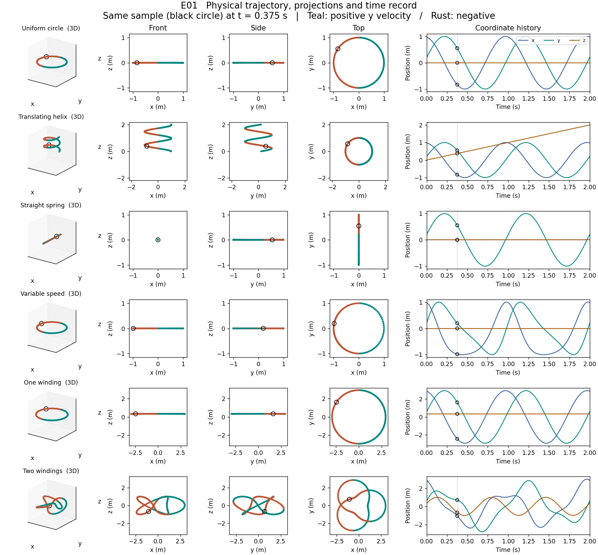
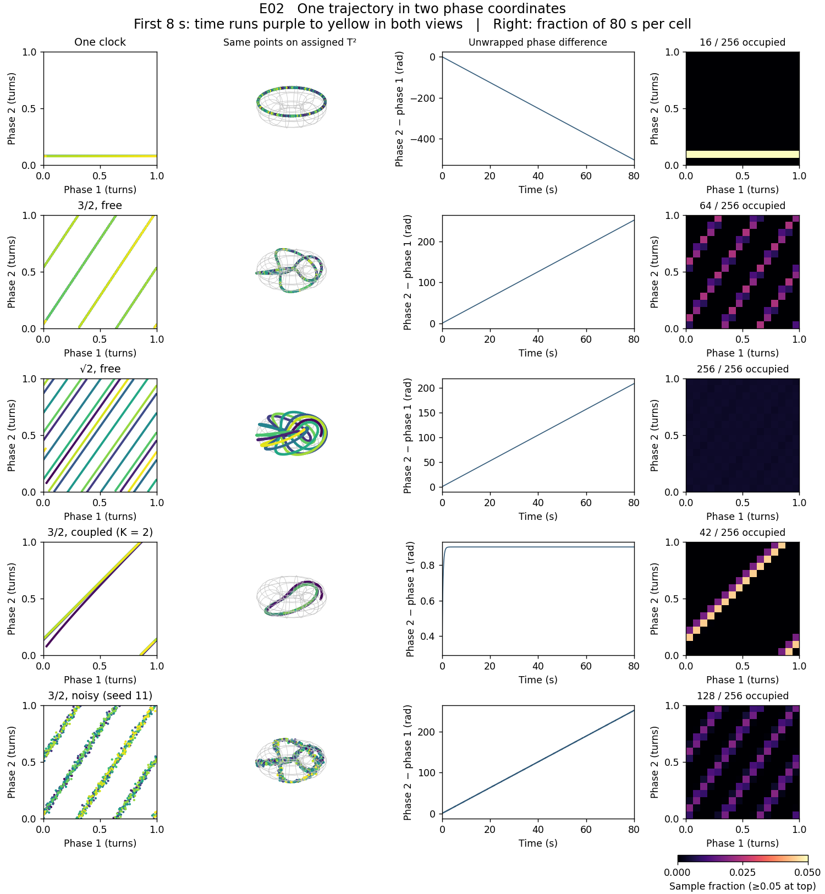

# 第1回研究報告　同じ波形から、どこまで元の運動が分かるか

続報のE03〜E08と現在の判断は[第2回研究報告](11_SECOND_RESEARCH_REPORT.md)に記録した。以下は初回時点の報告である。

2026-11-20（日本時間）。研究対象は「一つの動的な仕組みが、単体ではトーラス的な循環として現れ、単体同士の関係からより大きな構造が生まれる」という仮説である。

**今回、同じ運動が異なる形で観測される具体例と、その対応を逆向きに使う限界を確かめた。** 円を回る点を真横から見れば線分が見える。その点の一座標を時計に合わせて並べれば正弦波になる。さらに、まっすぐ往復するばねも同じ正弦波を与えた。「複数の見え方を持てる」はこの例で成立する。「その波を生んだ運動は一つに決まる」は成立しない。

二つの時計にそれぞれ円周上の位相を持たせると、可能な位相の組はトーラス T² で表せる。一回の運転で通る場所は周波数と結合によって変わる。今回、70秒で閉じる軌道が、観測方眼の全256区画を訪れた。面を広く通ったという集計だけでは、長周期の運動を見分けられなかった。

自然現象を抽出した標本は0件で、文献は目的に沿って選んだ。トーラスが自然界に現れる**頻度**、分野を越える**共通生成則**、現象の成立に対する**必須性**はいずれも未判定である。実験前に問い・予測・許容差・対照を固定し、数値の照合を済ませた。[事前登録](../experiments/REGISTRATION_E01_E02.md)・[主張台帳](../research/claims.json)

## E01　影に時間軸を加えると何が変わるか

円、螺旋、直線ばね、変速円、指定トーラス面上の一方向巻き・二方向巻きの6運動を調べた。1 Hz、2秒間、64・128標本/秒。基準と、初期位相および大半径を変えた事前指定の確認条件を合わせて24通り。各運動の一つの位置列から3D、正面・側面・上面、三座標の時間記録を作った。円は微小回転の合成で進め、位置の直接式を検算に用いた。乱数なし。[実装](../experiments/E01_projection/run.py)・[全条件の数値](../research/results/E01/summary.json)

| 比較 | 観測結果 |
|---|---|
| 等速円と解析式 | 全4条件で y と sin(2πt+φ₀) の最大絶対誤差は最大 **4.22×10⁻¹⁵ m**、RMSEは最大2.17×10⁻¹⁵ m。許容値は最大絶対誤差10⁻¹⁰ m。側面(y,z)でのzの幅は0 m。 |
| 同じy、異なる軌道 | 円と直線ばねのyの最大差は全条件で4.45×10⁻¹⁵ m未満。円ではxも変化し、直線ばねではxが一定。もう一座標を測れば区別できる。 |
| 円と並進する螺旋 | 1 m/sで軸方向に進む螺旋は、1秒後に上面で初期位置へ戻り、3Dでは1 m離れた。側面ではzを長さとして測っても y=sin(2πz/(1 m)+φ₀) の空間波形を得る。 |
| 等速と変速 | 同じ円周を通っても速さを周期的に変えると波形が歪んだ。基準条件・128標本/秒で y の第2高調波振幅は等速1.09×10⁻¹⁶ m、変速0.268 m。刻み半減でこの差は保たれた。 |
| 一方向巻きと二方向巻き | 指定面上で一方向巻きは1秒で戻った。基準の二方向巻きは1秒後に初期点から2.00 m離れ、2秒後の距離は3.65×10⁻¹⁵ m未満。これは指定面上の一本の線。全設定の両軌道で面の陰関数の残差は10⁻¹⁰ m²以内。 |

黒い丸はすべて同じ時刻の標本。二色は世界座標での y 方向速度の正負を表す。符号を決めたのは観測者であり、陰陽の物理的対応や相互作用は測っていない。

**砂時計状のくびれはどこまで手掛かりになるか。** 形の正解が分かる5面を同じ軸・標本数・無雑音で測った。上面の中心が空いていれば候補とする事前規則は、トーラスを拾うと同時に、円柱側面と一葉双曲面も拾った。正面で上端と中央の幅を比較に加えると、この5面を振り分けられた。

| 判定に使う観測 | トーラスを候補にした数 | 非トーラスを誤って候補にした数 | 内訳 |
|---|---:|---:|---|
| 上面の最小半径／最大半径のみ | 1/1 | 2/4 | 円柱側面・一葉双曲面が陽性。球面・二円錐が陰性 |
| 上面と正面の幅 | 1/1 | 0/4 | 指定したリングトーラスだけが陽性 |

この分母は人工的に選んだ形の種類数。異なる刻みやR/rで同じ面を測った回を、新しい自然標本として足していない。実物の未知の向き・遮蔽・雑音への性能や、砂時計とトーラスをともに生む速度場は未評価である。[同じ視点で描いた5面](../research/results/E01/surfaces.png)

## E02　可能な状態、一つの軌道、有限の観測

各時計を一周させても状態が変わらないため、二つの初期位相を自由に選べる系の全状態は S¹×S¹=T² になる。この仮定をコードに入れた。無結合・等速で周波数比が既約の p/q なら、第1の時計がq周する間に第2がp周し、組が初期状態へ戻る。厳密な無理数比では、理想的な連続時間の軌道は閉じず、その**閉包**が面全体になる。有限標本から無理数性や稠密性を証明することはできない。[MIT §1.2の確認](../research/notes/S003_phase.md)

第1周波数を1 Hzとし、5つの無結合条件、強さの異なる2つの結合、3種の観測雑音、計10条件を比較した。64・128標本/秒のそれぞれで8秒と80秒の窓を測った。再帰は、初期点との二つの最短角距離がともに許容差以内へ外から入った時に数えた。密度の分母は各窓の標本数（右端を除く）。次表は128標本/秒。再帰の主閾値は0.02 rad。[実装](../experiments/E02_phase_space/run.py)・[全40条件窓の数値](../research/results/E02/summary.json)

| 条件 | 訪問区画数／256（8秒 → 80秒） | 80秒での再帰回数・初回 | 読み取れること |
|---|---:|---|---|
| 一周期のみ | 16 → 16 | 80回・1秒 | 第2座標を固定した対照 |
| 1対1、無結合 | 32 → 32 | 80回・1秒 | 初期位相差0.32 radを保つ |
| 3/2、無結合 | 64 → 64 | 40回・2秒 | 解析周期2秒 |
| √2 指定、無結合 | 223 → 256 | 0回 | この時刻列と閾値における未検出 |
| 99/70、無結合 | 223 → 256 | 1回・70秒 | 全区画を訪れる周期軌道 |
| 3/2、結合 K=1 rad/s | 205 → 256 | 0回 | 後半40秒の位相差は平均2.437 rad/sで増加 |
| 3/2、結合 K=2 rad/s | 42 → 42 | 0回 | 位相差0.903339 radに同期。出発時の位相差は0.32 rad |
| 3/2、観測に雑音 | 101–103 → 128–131 | 0、4、7回（3種） | 元の周期は2秒のまま。観測された再帰と占有数は変化 |

**なぜ「戻った」「埋まった」が判定条件に依存するか。** √2指定と99/70の第2位相の差は8秒で0.003627 rad、70秒で0.031734 radだった。80秒窓で許容差を0.05 radに広げると、両者の再帰は64標本/秒でともに1回（初回70秒）、128標本/秒でともに3回（初回28.9921875秒）になった。さらに1秒ごとだけを見ると、第1の時計は毎回同じ位相で、両者とも80秒間で16区画しか訪れない。区画の占有、厳密な周期、観測上の近接は異なる量である。

実行後に解析式でも標本間を調べた。√2指定の連続モデルで t=70+s 秒と置くと、99周に近い第2位相と70周に近い第1位相のずれは、それぞれ 2π(√2(70+s)−99) と 2πs。両者が逆符号で同じ大きさになる s=(99−70√2)/(1+√2) ≈ 0.002092 秒では最大角距離が **0.013145 rad** まで下がる。主閾値の内側を標本と標本の間に通った。この補足は事前判定の変更ではなく、表の「0回」が意味する範囲を示す。

**結合と数値精度。** 位相差 δ=θ₂−θ₁ は δ̇=Δω−2K sinδ に従う。Δω=π rad/sのため、K=1では右辺が常に正、K=2では安定な一定差 asin(π/4) が存在する。後者で80秒の最終差と解析値の差は最大1.03×10⁻¹³ rad。同期しても、過渡を含む有限時間の回転数比は1.000929であり、初期状態への再帰は0回だった。無結合の直接解とRK4の最大差は9.78×10⁻¹¹ rad未満、結合時の位相和のドリフト残差は2.20×10⁻¹⁰ rad以下。結合時の刻み半減による最大差は8.35×10⁻⁷ rad未満で、登録値10⁻⁵ rad以内だった。

雑音は各位相の**読み取り**に標準偏差0.08 radで加えた。上表の範囲は固定した3種のばらつきであり、母集団の信頼区間ではない。独立な二つの直線振動を考えるだけでも、各ばねの位置と速度の組に位相を与えられる。二位相で記述できるという結果は、振動する物体そのものの立体形状を指定しない。

## 文献で確かめた物理的な違い

| 対象 | 資料で確認した範囲 | 中心仮説を区別するために残る測定 |
|---|---|---|
| 水の渦輪 | 成形翼で結び目・リンクを持つ渦を作り、変形と再結合を計測した一次研究の抄録。[S007](../research/notes/S007_vortices.md) | 同じ速度場で渦度の集中域、瞬間流線、物質の軌跡を比較する。 |
| 磁場 | トカマクの設計における二方向の磁場と閉じ込めを、DOEの解説本文で確認。[S005](../research/notes/S005_magnetic_field.md) | 装置が与えた幾何・駆動と、場が自ら保つ構造を分ける。 |
| 神経活動 | 記録した集団活動からトーラス構造を推定した一次研究の抄録。[S008](../research/notes/S008_grid_cells.md) | 観測データでの推定とシャッフル対照を再現する。 |
| 根・枝葉 | 木部と師部が運ぶ物質・供給先を教材で確認。葉脈研究の著者版では、主脈損傷後の色素の迂回と、変動需要で閉路が生じる輸送モデルを確認。[S009](../research/notes/S009_transport.md)・[Katiforiら](../research/notes/Katifori_transport_networks.md) | 同じ輸送則と材料量で、損傷後の機能を分岐網・閉路網について予測する。葉脈での迂回と樹木全体の成長機構は個別に測る。 |
| 宇宙空間 | Planckの一次論文の抄録は、立方3トーラスなどを背景放射で探索した尺度と非検出の制約を示す。[S015](../research/notes/S015_cosmic_topology.md) | 循環単位の相互作用が背景放射に何を予測するかを定める。 |

上表の物理・観測論文の外部データ再解析は0件。動画2本はフレーム・字幕・原図を直接照合できず、着想資料として引き継いだ。[環境とアクセス記録](../research/access/2026-11-20.md)

## 主張の判定と次の実験

- **H01・H02を指定条件内で支持。** 同一運動の観測写像（R1）と、二位相の数学的表現（R2）を校正した。円とばねは、観測したyについて同じ式 y″=−(2π)²y を満たす。発案者の問いにとって、同じ式が説明できる観測量を一つ具体化できた。
- **H11・H12の一般化には反例がある。** 波形の一致から元の運動を選べず、状態空間のトーラスから身体形状を選べない。砂時計と単一の物理的流れ（H03）、陰陽に対応する測定量（H04）、根と枝葉の生成（H05）、持続する単位や階層（H06）は開いたままである。
- **H07–H10は未判定。** トーラスを基本とするモデルと、輸送・相互作用などの下位の規則から特定条件でトーラスや分岐が生じるモデルが残る。今回の合成軌道はどちらの分野横断予測も試していない。
- **次はE03の基準場。** 半径と核幅を与えた渦輪、一方向流、せん断、局所回転を同じ観測器に入れ、速度・渦度・通過粒子のどの量に「中心」があるかを定量化する。輪の自発生成はE06で境界・駆動を変えて問う。樹木側のE04では、閉路があるときだけ損傷後の供給が保たれるのかを同じ総材料量で比べる。E08の出現率には別途、現象名から選ぶ分母が必要である。

実験前の登録、実行したコード、全条件の数値・観測列、図を保存した。同じ環境の新しい展開先で、予備試行を含む9ファイルの内容が再実行時にも一致した。[再開・再現手順](../research/STATUS.md)・[実行資源とコード版](../research/results/RUN.json)
