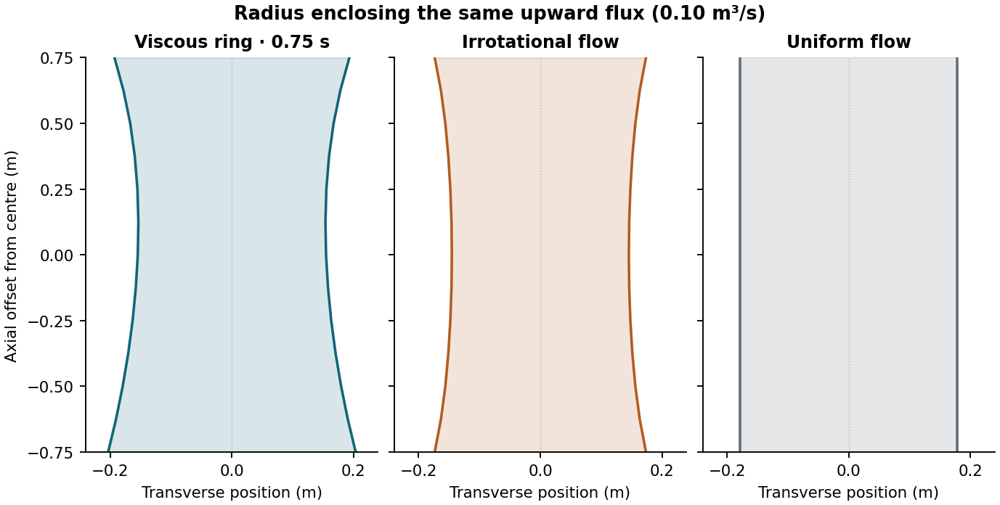
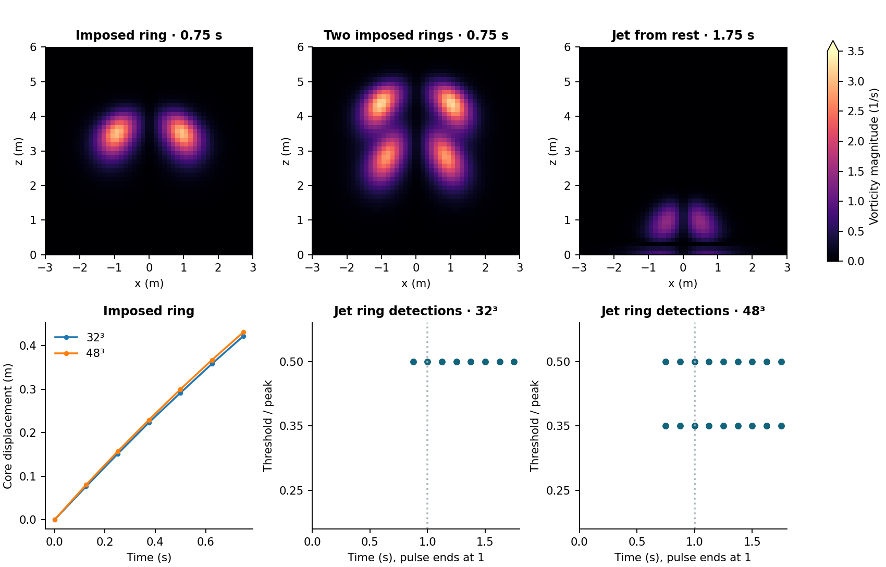
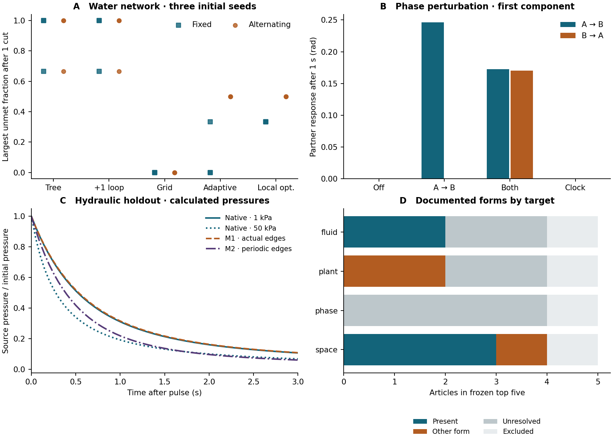

# 第2回研究報告　渦輪・砂時計・分岐はどこまで同じ仕組みで説明できるか

続報で流体・静磁場のエネルギーと閉経路の関係を確認した。[第3回研究報告](12_ENERGY_RESEARCH_REPORT.md)

2026-11-20 UTC。E01・E02の校正を引き継ぎ、計画にあるE03〜E08を実装・実行した。**一つの渦輪から、輪状の渦度と、軸付近で砂時計状に細くなる流れの両方を測れた。** そのくびれは渦度がゼロの流れにも生じた。「同じものの異なる見え方」はこの一例で具体化できる。一方、砂時計の形だけから原因は一つに決まらない。[観測量の登録](../research/registrations/E03-observers.md)・[全数値](../research/results/E03/observers/summary.json)

分野をまたいで予測が通ったのは、流体の小さな速度差と水路の小さな圧力差が均される速さだった。植物の成長、物質の閉じた循環、循環同士による宇宙の生成を、この式で予測できる段階には達していない。判断は、各実験を実行したことと区別して主張ごとに記録した。[主張台帳](../research/claims.json)・[前回の投影・位相の結果](10_FIRST_RESEARCH_REPORT.md)

| 問い | 今回得た答え | 証拠の範囲 |
|---|---|---|
| E03　一つの流れに輪とくびれが現れるか | 与えた渦輪で両方を検出。無渦の対照にもくびれが出た | 流体計算と解析的対照 |
| E04　根側から葉側へ運ぶには閉路が要るか | 木だけでも無損傷時は全量を供給。切断すると迂回路の配置で未供給量が変わった | 合成輸送網。外部植物データは分岐の寸法を別途検証 |
| E05　循環同士は互いの動きを変えるか | 位相への介入で直接結合と共通の時計を識別。二つの渦輪も単独時から移動量が変わった | 二種類のモデル。個体性・階層形成は未判定 |
| E06　輪を置かずに輪ができるか | 静止流体から始めた円形噴流で、細かい2格子が同じ9時刻に輪候補を検出 | 出口・時刻・渦度閾値に依存 |
| E07　同じ式で別分野を予測できるか | 流体で決めた係数が合成水路の小信号応答を予測。大信号では半減時間を外した | 予測先は別の方程式で合成。独立実測での採点は0件 |
| E08　どの程度よく現れるか | 固定順位20件のうち16件を採択。始動噴流の渦・宇宙論のモデルに記述あり。振動系は4件とも判定不能 | 論文単位の非無作為標本。自然界の頻度は未推定 |

## E03　速度・渦度・粒子と「中心」

半径1 m、核幅パラメータ0.4 m、循環4 m²/sの渦糸から初期速度を作った。動粘性0.05 m²/s、循環レイノルズ数80、幅6 mの自由滑り箱で非圧縮Navier–Stokes方程式を0.75秒進めた。空間差分は面に速度を置くMAC法、時間は2段の中点法、各段で圧力を解く。既知の軸上速度の最大絶対誤差は1.8×10⁻¹⁵ m/s以下。箱のTaylor–Green解に対する速度・圧力の相対L2誤差は細格子でそれぞれ2.45×10⁻⁶・1.07×10⁻³だった。[実装](../experiments/E03_vortex/fluid.py)・[校正結果](../research/results/E03/summary.json)

渦核の移動量は32³で0.42204 m、同じ格子で刻みを半減すると0.42203 m、48³で0.43101 mだった。細格子の核幅は0.264から0.416 mに増し、運動エネルギーは4.953から3.458 Jに減った。0.75秒で、速度最大は軸から0.088 m、渦度最大と圧力最小はともに軸から0.923 m付近、後二者の高さには0.125 mの差がある。観測終了まで輪が残った。終了後の寿命は未測定。[圧力・速度・渦度と位置](../research/results/E03/summary.json)

円筒の独立計算では、子午面上で渦度を輸送し、流れ関数から速度を計算した。24×48と48×96で移動は0.4193・0.4244 m、速度から測ったエネルギーと渦度から計算した粘性散逸の収支差は初期エネルギーの1.14%・0.29%。円筒と箱では外壁形状が異なる。7個の追跡粒子のうち、軸上の2個の核内滞在は0秒、核付近から始めた3個は0.75秒だった。別の既知解では、ある時刻に凍結した速度場の流線が1秒で閉じ、時間変化を追った同じ初期点の粒子は0.400 m移動した。[円筒計算](../research/results/E03/cylinder/summary.json)・[粒子・流線対照](../research/results/E03/summary.json)

**くびれの検査。** 既存の渦輪結果を見た後、新たな測り方を登録した。各高さで同じ上向き流量0.10 m³/sを囲む円板半径を計る。中央半径を上下0.75 mにある二つの端半径の小さい方で割り、0.92以下かつ最狭点が中央から0.125 m以内をくびれとした。48³の渦輪でこの比は初期0.734、0.75秒後0.801。後者で中央半径は0.155 m、両端は0.203・0.193 mだった。同じ操作による無渦のポテンシャル流は0.838、一定上昇流は1.000。対照の半径方向速度は 0.8sr、軸速度は 1.5+0.8(r²/2−s²) とした（sは中心からの高さ、rは軸からの距離）。両速度の交差微分が等しいので渦度はゼロで、軸速度が大きい中央ほど同じ流量を小さい断面で運べる。流量断面のくびれから厳密な双曲面や粒子の帰還は導けない。この範囲でH03を部分支持とした。[測定と対照](../research/results/E03/observers/summary.json)

無流動・一方向流・せん断流・局所回転流を同じ渦度検出器に通した。さらに壁・解像度・初期運動エネルギーを合わせた非圧縮ランダム場を3種×2格子で検査した。3閾値と平滑化の有無（σ=0.10 m）でランダム場の輪候補は0、与えた輪は全条件で陽性。ランダムな初期場に穴があり得るため、これは一般的な偽陽性率の推定には用いない。[ランダム場の全条件](../research/results/E03/observers/summary.json)

## E04　分岐、迂回、実際の枝径

25節点・40候補辺に流量＝伝導度×圧力差を置いた。水は根側2点から葉側3点へ、同化産物は葉側3点から根側2点および中央へ送る。無損傷時の総材料Σ√gを24に揃え、固定需要と消費先を交替する需要で、木・木＋1閉路・一様格子・局所適応則・材料制約付き局所最適化を比較した。3初期種、適応刻み2種、枝を残す閾値2種。すべての候補辺を一つずつ切り、各成分で実現できる供給を解き直した。144構成行×40切断の最大節点残差は1.08×10⁻¹³（総需要1）。[全条件](../research/results/E04/summary.json)・[切断別の数値](../research/results/E04/networks.npz)

水・固定需要・主閾値で、木は無損傷時に全量を供給し、最も影響する1辺の切断で種11・29・47の順に67%・100%・100%が未供給になった。一様格子はすべて0%。木に1閉路だけ加えた条件では最悪値が改善しなかった。局所適応則は同じ3種の固定需要で8・11・10閉路、交替需要では3種とも0閉路を残した。閉路数は (E-V+C) で、複数の搬送経路が取れることを意味する。流体が自分の出発点に戻ったことや、T²面の形成を測る量ではない。水と同化産物の端子位置、上下の極性、候補辺の90°・180°の角度は初期設定に含まれる。[計算条件](../experiments/E04_transport/run.py)・[植物生理の根拠](../research/notes/X5_source_sink.md)

植物はBrummerらの外部データから、樹全体・根群・枝先を別々に再集計した。5群の枝区間計5,205本が原論文の表1と一致し、全径が揃う2,024分岐点で接続枝の細径/太径の群別平均は0.591–0.627だった。対して種11の局所適応網では水・固定需要で0.650、交替需要で0.957。実物の外径とモデルから推定した管半径は別の測定であり、一方の値が近いことを生成則の適合と採点していない。[実データの版・定義・内訳](../research/notes/S012_branching_data.md)

## E05　同期と直接の相互作用

二つの位相を持つ系AとBを用意し、一方だけに20秒で0.4 radの外乱を加えた。共通の外部時計だけで同期させても、後半の位相固定度はほぼ1だった。Bを動かした1秒後のAの位相応答は共通時計で0、双方向結合で0.168–0.170 rad（種11、128 Hzの2成分）。A→Bだけの結合では順方向の応答は0.232–0.246 rad、逆方向は0だった。3種・2刻みすべてで事前予測の方向と一致した。[位相の介入と回復](../research/results/E05/phases/summary.json)

流体では二つの輪A・Bを同じ速度場で非線形に時間発展させ、同じ位置・強度から各輪だけを進めた計算と比較した。細格子・同方向・間隔1.6 mで0.75秒後の移動は単独時に比べそれぞれ+0.130・+0.027 m。間隔2.2 mでは+0.053・+0.027 m、反対向きでは−0.166・+0.166 mになった。中央面を横断したエネルギーの、二輪計算と単独2本の和との差は基準+0.928 J、反対向きでは対称性のためほぼ0 J。これは空間断面を通る正味流束であり、各輪に属する物質・エネルギーを一意に割り当てる追跡ではない。強度・核幅・粘性の変更を含む全条件を保存した。H06で部分支持できるのは相互作用と応答の部分までである。[全6条件と単独対照](../research/results/E05/)・[実在の連結した渦との違い](../research/notes/X1_X2_vortex_experiments.md)

## E06　静止からの生成と検出限界

初期速度をゼロにして下端から有限時間の噴流を与え、上端から同量を出した。円・楕円・スリットの各出口は同面積・同流量、基準の投入量はπ/2 m³。密度1 kg/m³、動粘性0.05 m²/s、等価直径2 m、基準の断面平均速度のピーク1 m/s、これに基づくレイノルズ数40。輪候補は、渦度の大きさが同一時刻のピークの指定割合以上の最大連結成分に、トンネル1・空洞0があり、箱境界に触れない場合に数えた。これは有限格子で観測した体積領域の検査であり、滑らかなトーラスとの同相性の証明にはならない。[事前登録](../research/registrations/E03-E08.md)・[位相の計算法](../experiments/E03_vortex/topology.py)

| 条件 | 32³での主閾値陽性時刻数 | 細格子での主閾値陽性時刻数 | 細格子の最初–最後の陽性時刻 |
|---|---:|---:|---|
| 駆動なし | 0 | 0 | 該当なし |
| 弱い円形 | 0 | 6 | 1.125–1.750 s |
| 基準の円形 | 0（時間刻み半減でも0） | 9 | 0.750–1.750 s |
| 楕円／スリット | 0／0 | 8／8 | ともに0.875–1.750 s |
| 長い円形パルス | 0 | 11 | 1.500–2.750 s |
| 側面周期の円形 | 0 | 9 | 0.750–1.750 s |
| 大箱8 mの円形 | 対象外 | 9（64³、基準48³と同じ格子幅） | 0.750–1.750 s |

基準箱は6 m、表の細格子は大箱を除いて48³。標本間隔は0.125 s、通常の観測窓は0–1.75 sの15時刻、長い噴流は0–2.75 sの23時刻。主閾値0.35で各条件を1計算ずつ数えると、48³の7条件で6/7、32³の同じ7条件で0/7。条件は意図して選んだ決定論的な設定で、自然の生成確率は推定できない。細格子では円形の渦度重心は終了時に入口から0.774 m、入口近くには上向き流束0.358 m³/sが残った。これだけでは独立した後続ジェットの存在は断定できない。[全時刻・投入量・収支](../research/results/E06/)

**格子を追加した結果。** 元の不一致を受けて、6 m箱のまま64³・同じ時間刻みを事前に追加した。円形条件で閾値0.25・0.35・0.50を順に見ると、32³は0・0・8時刻、48³は0・9・9、64³は8・9・9。主閾値では細かい2格子が同じ時刻に陽性となったが、0.25では判定が変わり、64³でも1.0秒だけ途切れた。64³の終端重心は0.784 m。側面周期群と自由滑り群の近い結果は、この対称な出口・観測窓で得たもの。観測終了まで続く陽性区間は右打切りである。名目ストローク/直径の範囲0.0625–0.50は、水槽のピストン実験が報告した形成数3.6–4.5と異なる。[追加登録](../research/registrations/E06-refinement.md)・[追加結果](../research/results/E06/circle_fine/summary.json)・[形成数の原典](../research/notes/X1_X2_vortex_experiments.md)

## E07　分野を越えた予測の範囲

候補式は、隣接する場所との値の差に応じて局所量を交換する (du_i/dt=κ∑_j w_{ij}(u_j-u_i))。訓練は粘性流体のせん断速度の減衰（m/s）。評価は7×7水路網の圧力（Pa）。時間の単位は前者で格子幅²/動粘性、後者で貯留係数/辺の伝導度とした。無次元係数κ=0.99679を流体側だけで固定。M1は水路の実際の接続、M2は対辺を縦横とも周期的に結ぶことを必須にした候補。M0は等温気室が圧縮される水路で液体体積を保存して解く分野固有モデルで、合成参照データの生成器でもある。対象で再調整した係数は全て0個。M1・M2は49×49行列の固有値分解各1回で161時刻、M0は各振幅で49変数を2精度で積分した。[評価前の条件](../research/registrations/E07-holdout.md)・[参照計算前に固定した予測](../research/results/E07/predictions.json)

| 初期圧力差 | 参照の半減時間 | M1の予測 | M2の予測 | M1／M2の全場RMSE（初期圧力差で規格化） |
|---|---:|---:|---:|---:|
| 1 kPa | 0.5214 s | 0.5315 s | 0.3847 s | 0.000441／0.017534 |
| 50 kPa | 0.2735 s | 0.5315 s | 0.3847 s | 0.013273／0.013726 |

小信号では、反対辺に1秒後に届く割合も参照4.41×10⁻⁶、M1が4.35×10⁻⁶、M2が0.09694と接続の効果が表れた。大信号ではM1の全場誤差が増し、半減時間だけならM2の方が参照に近い。M0の小さな誤差は積分精度の照合である。採点前に固定した二つの予測は成立した。[参照場と採点](../research/results/E07/summary.json)

両モデルに与えたのは既知の接続と初期圧力である。枝を成長させる規則や、流体の非線形移流から渦を作る機構に対応する項は共通化できていない。角度を状態に取る振動子にも同じ圧力・貯留量の対応は与えていない。外部フィルタ3個の原論文では遮断周波数が時定数から式で換算されており、独立に採点できた実測は0件。E07は線形緩和に対する限定的な分野横断予測で、H05・H08は未決である。[実測候補の確認箇所](../research/notes/E07_hydraulic_filter.md)

## E08　固定した文献群と分母

2010–2024年のCrossrefで現象名を使い、4分野ごとの関連度上位5件を順位のまま固定した。始動噴流では渦度領域、植物では葉脈全体の物理形、振動系では状態空間、宇宙論では空間位相という対象に限って判定した。判定可能分母についてWilson 95%区間を記し、採択分母では未判定を全陰性/全陽性とした上下限も示す。論文と研究開始時の資料索引とのDOIの重複は0件だった。順位標本のため、これらの区間が自然界の真の頻度を覆う保証はない。[固定順位](../research/results/E08/ranking.json)・[20件すべての採否・読めた段階・出典](../research/results/E08/summary.json)

| 対象（各5件から4件採択） | 陽性／陰性／未判定 | 陽性／判定可能数・Wilson 95% | 未判定率 | 採択4件での割合の上下限 |
|---|---:|---|---:|---:|
| 始動噴流の渦 | 2／0／2 | 2/2・34–100% | 50% | 50–100% |
| 葉脈の形 | 0／2／2 | 0/2・0–66% | 50% | 0–50% |
| 振動系の状態空間 | 0／0／4 | 分母0・推定不能 | 100% | 0–100% |
| 宇宙空間を扱うモデル | 3／1／0 | 3/4・30–95% | 0% | 75–75% |

噴流2件の陽性は数値モデル。植物の陰性には4種の葉の蛍光追跡と分岐グラフのモデルが含まれる。宇宙論の陽性3件はT³を候補として用いた文献で、宇宙での検出件数ではない。除外はM87の噴流、葉脈を模した装置、振動系の別DOI重複、同一著者による同じ宇宙モデルの再解説。最後を別の文献として含めれば宇宙群は4/5となる。計算領域の完全周期性は別欄にし、採択16件中、非完全周期と確認1、未確認6、非該当9。モデル空間の仮定を現象側の陽性に加算していない。[符号化データ](../experiments/E08_survey/coding.json)

題名の語だけで探す副判定では、内容で陽性の5件中1件を拾い、判定可能な陰性3件の誤検出は0。発見目的で「toroidal vortex」を検索した別枠5件は題名の語に5/5合致したため、現象名の分母と混ぜると偏る。既知対照では球、樹状体、平面波、一方向流の渦度、単一周期の5陰性中の誤検出は0。既知の固体トーラスと独立二位相は各対象の判定で陽性だった。球などの体積判定にはE03と同じコードを用い、位相数の対照では既知のモデル定義を参照した。単一評定者による小標本の校正である。[集計・検出器・対照](../experiments/E08_survey/run.py)

## 残る研究判断

- **波・陰陽・台風の目。** 円の一成分に正弦波が出る数学、位相の結合、渦輪の速度・渦度の関係にはそれぞれ支持がある。二色図に物理的意味を割り当てるには、何の符号・交換であるかを定め、介入で予測する必要がある。今回は台風の風・温度・上昇流の観測値を予測していない。[初回報告](10_FIRST_RESEARCH_REPORT.md)・[NOAAによる目と眼壁の構造](https://www.noaa.gov/jetstream/tropical/tropical-cyclone-introduction/tropical-cyclone-structure)
- **必要性と宇宙。** 「端子間の定常輸送には閉路が必須」という限定版には、同じ供給を満たす木が反例になる。階層をなす循環が世界を作るという主張には、その仮説に固有な背景放射などの観測予測がまだない。COMPACTとPlanckの対応円からの制約は、観測者を通るループや特定のT³のサイズに関するもの。[宇宙空間の制約](../research/notes/S016_cosmic_constraints.md)・[Planck](../research/notes/S015_cosmic_topology.md)
- **次に区別できること。** 数値で最もよく切り分けられた「渦輪とくびれの同居」を実験室の三次元速度場で同じ流量断面により検査する。分野横断の主張には、圧力の振幅と対辺の時系列を独立測定した公開網、または損傷前に枝の再形成を予測できる縦断データを、次版の評価標本として先に固定する。動画の原図候補と直接照合できた範囲は別途記録した。[動画の追跡](08_VIDEO_NOTES.md)・[再開手順と検証記録](../research/STATUS.md)

25プロセスを独立した作業ディレクトリで再実行し、校正・対照・収支の70項目を満たした。生成した図・数値64ファイルが同一環境でバイト単位で一致した。これは計算の再現性の確認である。[実行時間・メモリと照合記録](../research/results/SECOND_RUN.json)・[追試手順](../research/STATUS.md)
