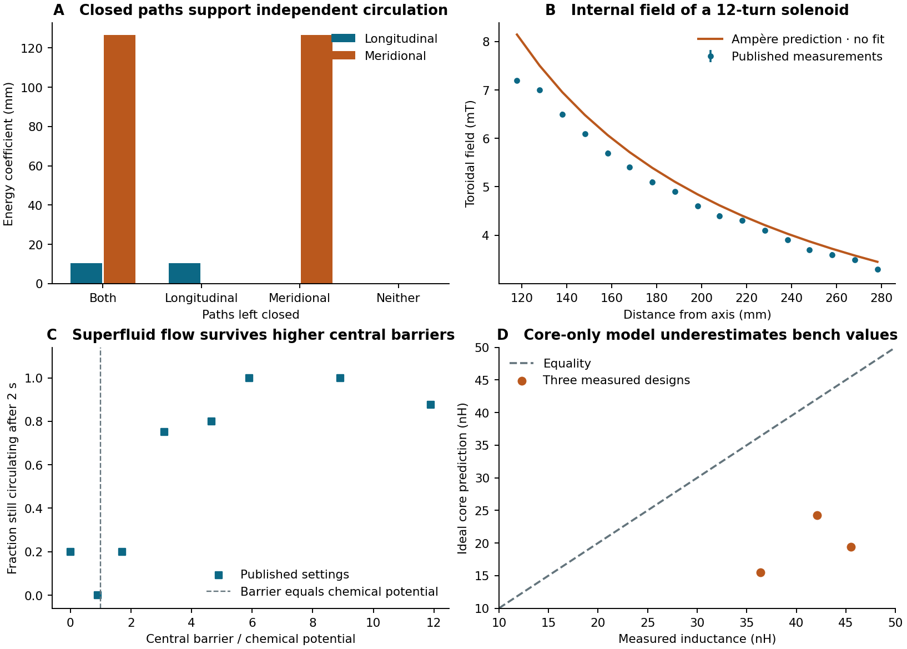
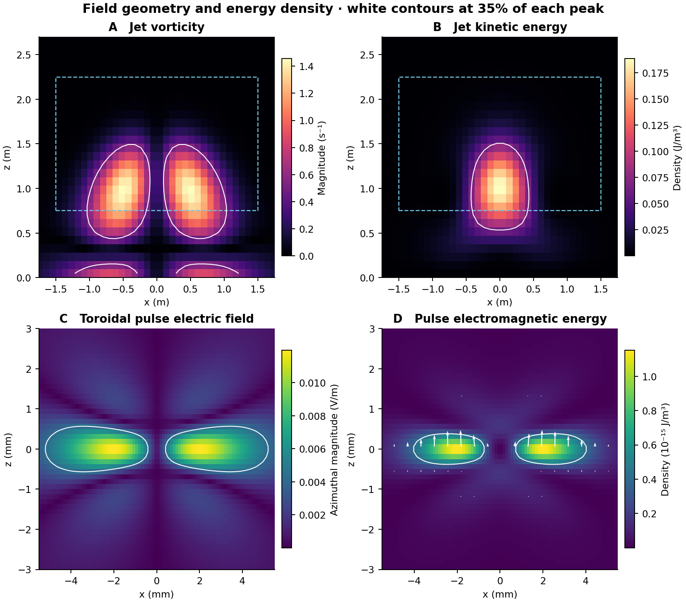

# 第3回研究報告　循環する経路とエネルギー

2026-11-20 UTC。**トーラスが、エネルギーを伴う循環を支える共通の原理になることを、非圧縮の無渦流と、電流のない領域の静磁場について支持できる。** 同じ形の領域でも、境界をどの方向で切るかによって、独立した循環の数と、蓄えられるエネルギーが変わる。この関係を式で導き、数値計算と公開実験で照合した。[事前登録](../research/registrations/E09-E11-energy.md)・[主張台帳 H13](../research/claims.json)

渦と光の輪が現れる位置にも、別の共通条件があった。回転対称な場の周方向成分は軸上で消える。成分の強い領域が軸から離れて局在すると、輪ができる。**エネルギー密度の最大領域が輪になるかは、場の全成分で決まる。** 円形噴流では回転が輪を作り、運動エネルギーは軸近くに集中した。光の解析解では、エネルギー密度そのものが輪になる条件も確認した。[第2回の渦輪とくびれ](11_SECOND_RESEARCH_REPORT.md)・[場とエネルギーの断面図](../research/results/energy_figures/fields_and_energy.png)

| 問い | 今回の判定 |
|---|---|
| エネルギーを伴う循環は閉じた経路に依存するか | 支持。トーラス殻で閉じた方向を2本、1本、0本と変えると、独立な循環も2、1、0。流体と静磁場で同じ幾何係数が使える。 |
| その関係は公開実測を説明するか | 一部を支持。装置の巻数と電流で内部磁場17点を予測。超流動で穴を保つ条件ほど循環が持続。コイル全体のインダクタンスと、写真の半径からの超流動の回転率は精度基準に届かず。 |
| 局所則で生じる輪の形は分野を越えて予測できるか | 設定範囲内で支持。新しいパルス設定と円形噴流で、一断面からの予測は三次元の判定と計40/40一致。 |
| 波・植物・陰陽・宇宙を一つの力学で説明できるか | 全体の仮説は未決。今回支持した範囲は閉経路の調和場と、軸から離れて局在する周方向成分に及ぶ。 |

## E09　閉経路が決める循環とエネルギー

滑らかな壁の中で、境界を横切らず、発散も回転もゼロの場を考える。領域内で潰せない経路が1本あれば、その方向に調和場を1成分置ける。この場の二乗の体積積分に、流体では密度の半分、磁場では透磁率の逆数の半分を掛けると、各エネルギーになる。

たとえば、中心線の半径が (R)、円形断面の半径が (b) の充実トーラスで、軸からの距離を (r) とする。周方向の速度は (Gamma/(2pi r))（(Gamma) は周回に沿った速度の積分）、理想コイルの内部磁場は (mu_0NI/(2pi r))。同じ (D=R-sqrt{R^2-b^2}) が、エネルギーと断面流束に現れる。

| | 流体 | 静磁場 |
|---|---|---|
| 周方向の強さを決める量 | 循環 (Gamma)（m²/s） | 巻数 (N) と電流 (I)（A） |
| 断面を貫く量 | 体積流量 (DGamma)（m³/s） | 磁束 (Dmu_0NI)（Wb） |
| 領域内の蓄積エネルギー | (
ho DGamma^2/2)（J） | (mu_0 N^2 D I^2/2)（J） |

同じ断面流束を保つ発散なしの場の中で、調和場はエネルギーを最小にする。余分な場と調和場の内積を区分積分すると、外壁の寄与はゼロになり、切断面の寄与も余分な流束がゼロなので消える。追加した場のエネルギーだけが増える。この議論と同じ式を、流量または磁束を固定した問題に使える。静磁場で電場がゼロならポインティング流束もゼロで、このエネルギーは静的な蓄積量である。[導出と文献](../research/notes/Cantarella_topology_energy.md)

厚みのある殻（(R=0.15) m、断面半径0.025〜0.060 m）を3段階の格子で解いた。周方向と断面方向がともに閉じている場合、各方向の単位周回エネルギー係数は0.010425 mと0.126543 m。片方を切ると対応する係数がゼロ、両方を切ると循環の自由度は0になった。断面方向の細かい2格子の差は0.0061%。単位場に零貫通流束の回転を加えた試験では、全6場で交差項が数値誤差内のゼロだった。充実トーラスの指定例では、水に相当する密度と循環で運動エネルギー0.0401 J、同じ寸法の120巻き・1.4 Aの理想コイルで磁気エネルギー0.000222 Jになった。[E09の数値・境界条件](../research/results/E09/summary.json)

## E10　装置の予測を公開測定で照合

**磁場。** MEPhIST-0の装置論文から巻数12を取り、400 Aでの磁場を予測した。測定図から読み取った半径約118〜278 mmの17点で、(B_phi=mu_0NI/(2pi r)) の絶対相対誤差中央値は4.88%。等しい半径の範囲で1点規格化した比較では、残り16点の中央値が (1/r) で1.36%、一定場で21.79%だった。磁気エネルギー密度 (B^2/(2mu_0)) の対応も各点で計算した。読取値には元の計器誤差とは別に図の分解能が効く。コイル全体を測ったLeらの別の実験では、3設計で理想芯の15.5〜24.3 nHに対し実測は36.4〜45.5 nH。相対誤差中央値57.3%で、事前基準20%を満たさなかった。芯の外や巻線に関わる寄与も実物では測定に入る。[巻数・測定図・除外理由](../research/notes/E10_energy_observations.md)

**超流動。** Ryuらの中央障壁の実験では、2秒後の持続率の設定別中央値は、穴が開く境界以下の2設定で10%、上の6設定で約84%だった。障壁の変更は経路と同時に中心密度や渦のピン止めにも作用する。Kumarらの別の実験では、静止写真から読んだ半径13.45 µmに対して、巻数1の運動エネルギーを原子1個当たり約8.1×10⁻³⁴ J、定在波の節線の回転率を0.875°/msと予測した。巻数の符号を逆にすると、公表図から読み取った回転率の符号も逆になった。回転率の絶対相対誤差中央値は46.5%で、25%の基準を満たせなかった。写真は31×31画素で、方向別の半径は11.94〜14.97 µmだった。原子の運動エネルギーは予測量、回転率は密度画像から読み取った観測量である。[各式・図の読取りと採点](../research/results/E10/summary.json)・[元の論文と読取り手順](../research/notes/E10_energy_observations.md)

## E11　輪の中のエネルギーはどこを通るか

流体で追ったのは運動エネルギー密度 (e=
ho|u|^2/2)。内部の固定検査体積を出入りする圧力仕事、移流、粘性による輸送を面ごとに積分し、粘性散逸と蓄積量の変化に照合した。円形噴流の64³格子で、時刻1.75 sまでの正味流入は約0.296 J、粘性散逸は0.207 J、終了時に残った量は0.082 J。内部収支の残差は評価区間最大で1.61%、48³の結果は2.67%だった。同じ設定で、渦度の0.35等値領域は両格子で9時刻に輪候補となり、運動エネルギーの最大領域は同じ閾値で0時刻。最終時刻のエネルギー密度の最大点は半径0.066 m、渦度の最大点は半径0.483 mだった（64³）。[収支・等値領域・全時刻](../research/results/E11/fluid/summary.json)

光パルスでは磁場を含めて電磁エネルギー (e=(epsilon_0|E|^2+|B|^2/mu_0)/2)、波が運ぶ電力をポインティング流束 (S=E	imes B/mu_0) とした。進行平面波と定在波を対照に、Maxwell方程式と円筒を通る収支を検査した。大きい (q_2=20) の虚部から作るパルスでは、両格子・全3時刻・全3閾値で電磁エネルギー密度に輪候補が現れた。同解の実部では、電場に輪があってもエネルギー密度の最大領域は軸につながった。電磁エネルギーが輪になる例でも、円筒の下面からの流入と上面からの流出を検出した。計算でのエネルギー収支残差は全8条件で0.0021%未満。公表実験の場の再構成法は確認したが、この環境では論文指定のデータDOIに到達できず、実測の流束は再計算できていない。[光の計算結果](../research/results/E11/light/summary.json)・[理論・実測とアクセス](../research/notes/E11_toroidal_light.md)

## E12　形の共通条件を別設定で予測

滑らかな回転対称場では、軸上の方位成分はゼロになる。軸から離れた非退化な最大点の近くでは、十分高い等値領域が断面内の小さな円板になる。軸の周りにこの円板を回すと、充実トーラス (D^2	imes S^1) になる。この幾何学的な仕組みを、流体の方位渦度と真空パルスの方位電場に適用した。スカラーのエネルギー密度でも、軸外に局在したピークがある場合には同じ形が生じる。[閾値・採点方法の事前登録](../research/registrations/E12-meridian-prediction.md)

E11とは別に登録した条件で、片側の断面の形から、全三次元格子の独立判定を予測した。最大値の50%の閾値で、真空パルス24/24（陽性16・陰性8）、円形の弱い噴流・長い噴流16/16（陽性8・陰性8）が一致。35%でも各群全件で一致した。スリットの比較8/8も一致した。この有限設定では回転対称性を弱めても同じ形の判別ができる例がある。件数は同じ計算内の時刻や場を含み、自然標本には換算しない。巨視的な輪の形を予測する幾何の証拠であり、流体と光に同じ時刻発展方程式を当てた試験ではない。[パルス24件](../research/results/E12/light/summary.json)・[円形噴流16件](../research/results/E12/circle/summary.json)・[スリット8件](../research/results/E12/slit/summary.json)

## 共通原理をどこまで支持するか

**閉じた循環の自由度とエネルギーを決める原理としてのトーラスを支持する。** 境界で一周できる向きの数に物理的な意味があり、形とエネルギーの関係を定量化できる。渦と光には、軸を避ける局在した場の成分が輪を作るという共通条件もある。これに対応する二つの限定命題を台帳に追加した。[H13・H14](../research/claims.json)

根と枝葉に対して現在確認できるのは、閉路ゼロでも圧力差による定常輸送とエネルギー散逸が成立することまで。正の伝導度を持つ受動網では辺に沿って圧力が下がり続けるため、圧力仕事だけで有向の閉経路を巡回する定常流は作れない。循環する経路、光合成と物質交換、成長に必要なエネルギーは追加で測定すべき量になる。陰陽に対応する固有の観測量と、動的な宇宙モデルの予測も未定義。全ての現象の基礎という広い命題の判定にはこうした証拠が残る。[分岐の対照 E04](../research/results/E04/summary.json)・[証拠台帳](03_EVIDENCE_LEDGER.md)

E09〜E12を別の作業場所に展開したコードで再実行し、24項目に合格、図と数値を含む16ファイルがバイト単位で一致した。実測に対する不支持も結果ファイルに入っている。[実行ログ](../research/results/ENERGY_RUN.json)・[再開と追試](../research/STATUS.md)
