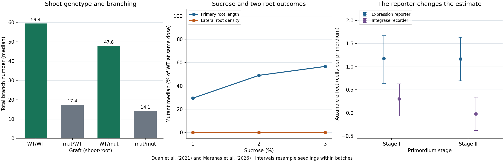
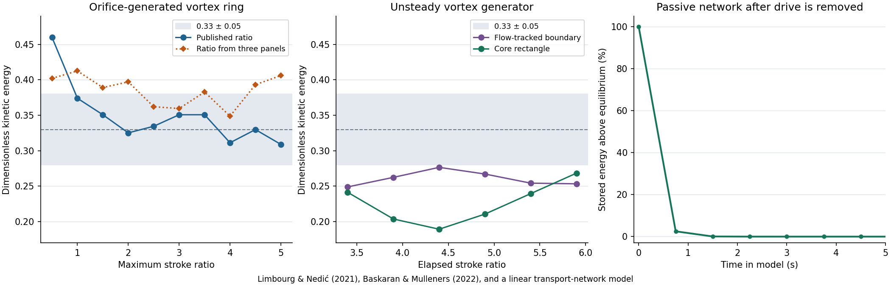

# 第11回研究報告　根の輸送・周期の予測と、循環を支えるエネルギー

2026-11-20 UTC、E33〜E38。**成長と輸送の二つの待ち時間を持つ式が、別の生体試験の4系統で、側根の準備信号の周期を固定周期・固定距離の対照よりよく予測した。** 根の表皮から中心柱に及ぶ応答にも、輸送経路の関与を示す介入が見つかった。物理側では、閉じた経路の定常循環を維持する仕事率を、流体・電気・化学輸送に共通する式で示した。渦輪の実測では、エネルギーを循環と力積から求める係数は、装置や輪の定義によって変わった。[一次資料と照合範囲](../research/notes/E33_E38_return_and_energy_evidence.md)

## E33　外側から根の内側に届く作用

Huらはシロイヌナズナの表皮でオーキシン（IAA）の合成を誘導し、分化域の内側にある中心柱のDR5:VENUS蛍光を測った。公開ワークブックから、誘導単独と輸送阻害剤を併用した時の蛍光を再集計した。表皮→中心柱では、誘導単独の平均30.05 RFUに対し、NPA併用0.73、1-NOA併用26.50だった。[Hu et al. Fig. 5](https://doi.org/10.1038/s41467-021-21802-3)・[各測定値と平均](../research/results/E33/summary.json)

| 合成を誘導した場所と応答を測った場所 | NPAで残った応答 | 1-NOAで残った応答 |
|---|---:|---:|
| 表皮 → 分化域の中心柱 | 2.4% | 88.2% |
| 中心柱 → 伸長域の外側 | 2.2% | 29.7% |
| 中心柱 → 根端近く | 7.4% | 339% |

いずれも同じ誘導系統・測定位置の誘導単独に対する蛍光の比。NPAでは上の3方向すべてで減少した。1-NOAでは外側への応答が強く低下し、内側への応答は大部分が残った。根端の強い増加も含めて記録した。表皮の局所除去では1時間後の図の上下の平均差は−0.017、24時間後は+0.974だった。ワークブックの細胞・測定領域と植物を区別し、個体IDのない読み値から新しい検定は求めなかった。薬剤は複数の過程に作用し得る。蛍光はオーキシン応答を示すので、同じ分子が外へ出た後に戻るか、どの位置を通るかは未判定。[阻害と局所除去の結果](../research/results/E33/summary.json)

## E34　別の成長介入で準備信号の周期を予測

De Gernierらの実験では、エチレン産生を変えた根で、根端が伸びる速度とDR5発光の準備信号の周期を測った。元のE29は細胞生産率を使った。今回は同じ根での成熟皮層細胞長が公表されていないため、成熟細胞長が共通という条件で、伸長速度の比から周期を予測した。E29から成長に依存しない待ち時間 `τ=1.062時間` を固定し、別の試験の野生型1群から基準の速度 `v0` と周期 `T0` を読んだ。各系統の速度を `v` とすると、予測は `T=τ+(T0−τ)v0/v`。残りの4系統はすべて採点に回し、係数を合わせ直さなかった。[De Gernier et al. Fig. 3、S3](https://doi.org/10.1093/plphys/kiaf382)・[採点と図の読み値](../research/results/E34/summary.json)

| 系統 | 伸長速度〔µm/時〕 | 実測周期〔時〕 | 二待ち時間の予測 | 固定距離の予測 |
|---|---:|---:|---:|---:|
| 野生型（基準） | 221.1 | 2.72 | 2.72 | 2.72 |
| eto2 | 121.1 | 3.68 | 4.09 | 4.97 |
| line 1 | 200.9 | 2.72 | 2.89 | 2.99 |
| line 4 | 143.0 | 3.24 | 3.63 | 4.21 |
| line 2 | 55.3 | 7.57 | 7.70 | 10.88 |

固定周期は全系統で2.72時間。4系統の対数RMSEは二待ち時間0.084、固定距離0.274、固定周期0.541だった。良い方の対照より約69%小さい。速度・周期の読取りを各中央値で±2画素ずらした1,024通りの端点の組み合わせのうち、969通りで二待ち時間式が両対照を上回った。この割合は図の読取りに対する感度を表す。E29とは異なる試料・介入を使い、著者の一部は共通。既刊図による比較で、原著が報告した増減の方向は登録前から既知だった。成熟細胞長が測られていないため、E29の二つの係数をそのまま用いた予測の検証と、待ち時間を生む輸送の同定は残る。[全誤差と必要な成熟細胞長](../research/results/E34/summary.json)

同じ実験で、最も遅いline 2の主根1 mmあたりのピーク密度は野生型の約1.85倍だった。途中で中断した部位は野生型21/62、line 2で12/22。ピーク密度に進行した割合を掛けた群の推定値は1.27倍となり、別日齢の出現側根密度は1.03倍だった。周期・ピーク密度・後の側根密度はそれぞれ独立に記録する必要がある。異なる日齢や試料の値から対応する個体の分岐率は推定していない。[原著のTable S4と実測照合](../research/results/E34/summary.json)・[方向と周期の比較図](../research/results/return_energy_figures/root_transport_and_period.png)

## E35・E38　エネルギー源と発生の段階を分ける

**地上部の作用。** Duanらは光合成に関与するCYP38の変異株と野生型を接ぎ木した。変異型の根に野生型の地上部を接ぐと、根の総分岐数の中央値は約14から約48へ増えた。野生型の根でも地上部が変異型なら約17、地上部も野生型なら約59だった。通常光のショ糖1→3%で変異型の主根長は0.93→1.71 cmに伸びたが、出現した側根の密度の中央値はゼロ線にとどまった。ショ糖は化学エネルギー源にも信号にもなる。照度、接ぎ木、補充の実験はその地上部の過程と根の形成の関係を示す。ATPや糖の流束の計測は含まれない。[Duan et al. Fig. 3、6](https://doi.org/10.1093/plphys/kiaa032)・[全処置の値](../research/results/E35/summary.json)

**どのマーカーで測るか。** Maranasらの公開CSVでは、比較した2種類の記録法に67株のデータがあった。オーキシン応答を抑えた時、第I段階の原基1個あたりのGATA23陽性細胞数は、発現を読む方法で4.31→5.49、閾値を越えた発現を記録する方法で4.24→4.55だった。ばらつきのSDは順に1.37→2.07、1.65→1.87。平均の処置効果の差は+0.875細胞で、個体を単位に培養の反復内で再標本化した95%区間は+0.255〜+1.490。第II段階でも処置効果の差は+1.19細胞だった。早期原基数が2種類のCSVで食い違った2株を除いても主要な方向は保たれた。区間は2回の培養を固定した値。異なる記録系の比較であり、観察した細胞の運命そのものを追跡した試験は未実施。[Maranas et al.](https://doi.org/10.1093/genetics/iyag120)・[Dryad v8](https://doi.org/10.5061/dryad.g4f4qrg51)・[再集計](../research/results/E38/summary.json)

## E36　渦輪のエネルギーはどこまで同じ式で予測できるか

運動学的循環を Γ、軸方向の流体力学的力積を I、流体密度を ρ、運動エネルギーを E とする。実測と照合した無次元量は `E*=E/√(ρ I Γ³)`。一定速度で生成した渦輪に関する既報から0.33を固定し、別の二装置の速度計測由来の量を採点した。行程比は、排出する流体の長さの尺度を開口径で割った量。装置間で同じ値が保証される条件にはしていない。[係数の出典と依存性](https://doi.org/10.1017/jfm.2022.275)・[事前登録](../research/registrations/E36-vortex-ring-energy-transfer.md)

| 装置と使った観測 | 終盤の無次元エネルギーの中央値 | 0.33±0.05に入った点 |
|---|---:|---:|
| オリフィス、原著の E*（下流の視野、行程比3〜5） | 0.330 | 5/5 |
| 同じ装置、別々に掲載された Γ・I・E を組み合わせた値 | 0.383 | 2/5 |
| 時間変化する模倣装置、流体の移動から決めた輪の境界 | 0.254 | 0/2 |
| 同じ模倣装置、渦核の周囲の矩形 | 0.254 | 0/2 |

オリフィスの行程比0.5では原著の E* は0.460。行程比3〜5の各図から Γ と I を読んで0.33を掛けると、Eの絶対相対誤差中央値は13.8%だった。別々の図の Γ・I・E から組み直した E* は、原著の E* と最大0.097ずれ、各図を±3画素の幅で読んでも10条件のうち6条件では重ならなかった。各図の点に対応する生の速度データと同時刻の標本は未取得。時間変化する装置では、境界を変えても終盤の係数は約0.254だった。既刊文献で知られていた係数の違いを、行程と評価する境界を指定して数値で再確認した。[オリフィス](https://doi.org/10.1017/jfm.2021.36)・[時間変化する装置](https://doi.org/10.1017/flo.2022.9)・[単位換算と採点](../research/results/E36/summary.json)

## E37　閉路を流れるときの仕事と散逸に共通の式がある

線形の輸送網で、辺に沿って流れを起こす外部駆動を `w`、節点のポテンシャルを `μ`、流量を `J`、外との出入りを `s`、各辺の伝導度を `g` とする。辺ごとの抵抗損失は `J²/g`。向きをそろえて合計すると、定常では `Σ J²/g = wᵀJ + μᵀs` になる。これは各辺の流量にポテンシャル差と駆動を掛け、節点での保存則を使うと導ける。外との出入りがゼロの単一閉路では、一周の駆動の和を一周の抵抗の和で割ると循環量が求まる。[導出と計算条件](../research/notes/E33_E38_return_and_energy_evidence.md)・[全ケース](../research/results/E37/summary.json)

同じ式を圧力と体積流量、電圧と電流、化学ポテンシャルと物質流量に割り当てると、各積はいずれもワットになる。有限の初期エネルギーを与えた受動網では、散逸でポテンシャル差が消え、閉路があっても定常の流れはゼロになった。駆動を保った閉路では循環が続き、片側を切った網では外から供給と排出を行えば流れ続けた。2本の独立した閉路のうち1本を切ると循環の自由度が1つ減った。これは線形・正の抵抗の模型での結果。慣性のある渦輪や生体の成長を同じ状態変数で解いたものではない。[駆動・残留エネルギー・収支](../research/results/E37/summary.json)

## 共通原理として支持が強まった範囲

根では、**成長速度が変わると準備信号の周期がどう変わるか**の予測が、別の試料の介入でも通用した。さらに外側から内側へ及ぶ応答が輸送の阻害で変わる。次に同じ根で、外側を通った標識の再到達と成熟皮層細胞の長さを測り、再到達の時刻で次の信号を予測できれば、戻り輸送を成長と分岐につなぐ因果の支持が強まる。独立した供給で同じ応答が出る場合も比較対象に残る。[主張台帳 H05・H29・H33〜H35](03_EVIDENCE_LEDGER.md)

物理では、**閉経路のつながり方と駆動の仕事が循環量を決める**という条件付きの共通原理を支持できる。閉路が一つある線形網でも成り立ち、三次元のトーラスができるかどうかはさらに空間の測定に依存する。植物の形成を先導するトーラス状エネルギー場、全現象への普遍性、宇宙全体の仮説は未判定。今回の範囲では、資源供給・輸送・仕事率・観測される形をそれぞれ数値で試せるところまで進んだ。[実験と追試の記録](../research/STATUS.md)・[主張台帳](../research/claims.json)
