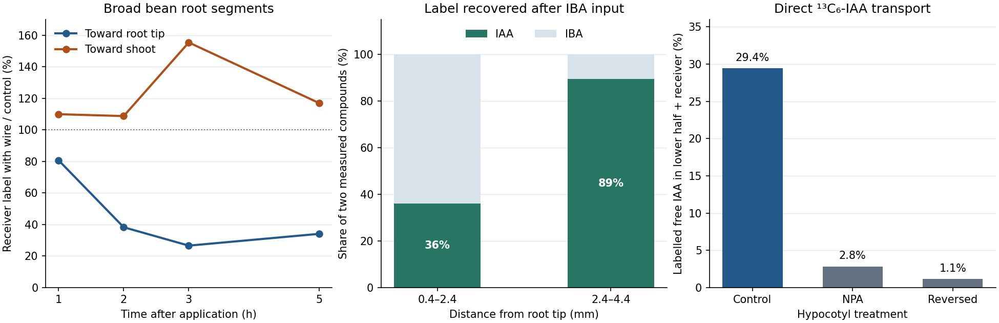
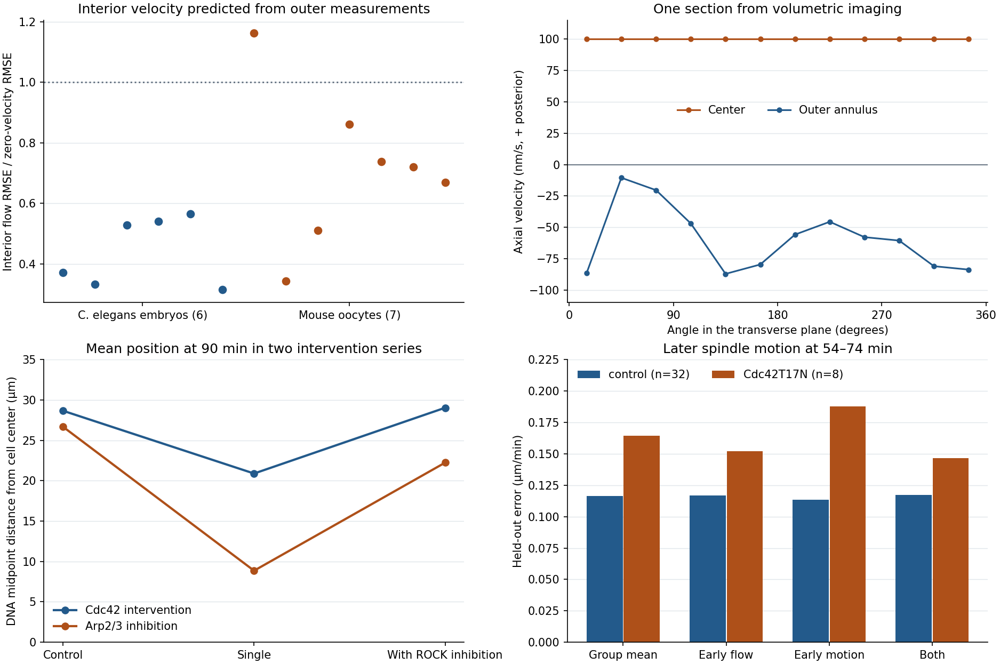

# 第13回研究報告　根で同じ物質は戻るか、形が現れる前に何が流れるか

2026-11-20 UTC、E44〜E48。**根端へ向かう輸送と地上部へ向かう輸送が、根の異なる組織に依存することは、ソラマメの実測で支持できる。最初の細胞分裂より前に、線虫胚の中心部とその周囲で、細胞質が逆向きに流れることも支持できる。** 前者には天然のオーキシンであるインドール酢酸（IAA）の標識と組織への介入、後者には三次元撮影と、独立に保留した測定位置への予測を使った。根の同じIAA分子が一周するというH44と、身体形成に先立つ三次元トーラス状のエネルギー循環が後の形を決めるというH45は、どちらも未判定である。[主張台帳](../research/claims.json)・[一次資料の対応表](../research/notes/E44_E48_measured_return_evidence.md)

## 根のどの組織を、何が通るか

無傷のソラマメの根に、根端から4〜5 mmの位置で環状に標識IAAを与えた原著がある。10、30、60分後に標識の先端が進んだ距離は、根端向きで1、2、4 mm、地上部向きで2、4、8 mmだった。20分時点の切片では、投与点から地上部側にある外側組織と、根端側にある内側組織に標識が見えた。30分には地上部側の内側にも現れた。著者は、この内側に来た標識がその後根端側へ向かう可能性を指摘した。各時刻で別の根を切っており、投与点から内側へ直接入る経路も残る。これは帰還が起こりうる位置についての観測である。[Ohwaki・Tsurumi（1976）図7と本文](https://doi.org/10.1093/oxfordjournals.pcp.a075396)・[E44](../research/results/E44/summary.json)

次の原著では根端から3〜6 mmの部分を切り出し、中心部に細い線を通した根片と対照を比べた。片端に標識IAAを与え、反対端で回収された放射能を公表図から読んだ。5時間後の結果は次の通り。[Tsurumi・Ohwaki（1978）図8](https://doi.org/10.1093/oxfordjournals.pcp.a075700)・[各時刻と読取り座標](../research/results/E44/summary.json)

| 受け取る方向 | 対照（壊変数/分） | 中心への介入後（壊変数/分） | 介入後／対照 |
|---|---:|---:|---:|
| 根端向き | 192.0 | 65.3 | 34.0% |
| 地上部向き | 99.0 | 115.8 | 117.0% |

根端向きの輸送は約3分の1まで減り、地上部向きには同じ低下が見られなかった。図の点を上下3画素ずらした残存率の範囲は32.4〜35.7%と111.9〜122.4%。これは図を読む際の幅で、地上部向きの増加の統計的有意性を表さない。生きた根の組織位置と、この損傷を伴う介入を合わせると、中心側が根端向きの輸送に大きく寄与し、外側を通る地上部向きの経路があるという解釈への支持が強まる。[登録と対照](../research/registrations/E44-tissue-routes-of-labelled-IAA.md)

化学形も照合した。同じ1978年の研究の別条件では、表面に標識IAAを与え、4時間後に両方向で回収した標識を薄層クロマトグラフィーにかけた。原著の回収率は72%、そのうち両方向とも約80%がIAA標準と同じ位置に移動した。図3の10区間を積算した地上部向き／根端向きの比は2.51で、本文の2.7と幅がある。化学分離をした受け側の試料と、線を通して方向差を測った根片は別々である。[原著図3](https://doi.org/10.1093/oxfordjournals.pcp.a075700)・[区間ごとの読取り](../research/results/E44/summary.json)

シロイヌナズナでは、根端に標識インドール酪酸（IBA）を与えた2時間後、分離して回収したIAAとIBAの合計に占めるIAAは、根端から0.4〜2.4 mmで36.0%、2.4〜4.4 mmで89.3%だった。差は53.3ポイント、図の読取りによる差の幅は±2.7ポイント。IAA自体を与えた別試験では、野生型の同じ二切片に総標識が約61.7、31.1壊変/分あったが、この二試料では化学形を分離していない。一方、同種の**胚軸**では、安定同位体で標識した遊離IAAそのものを質量分析で定量できた。5時間後に下半分と受け側にあった量は通常17.1、輸送阻害剤NPAあり1.3、切片を逆向きにすると1.0 pg/株だった。植物組織を通過したIAAの同定には実例があり、根で標識だけを追った場合には、途中で化学形が変わる量も無視できない。[Růžičkaら、図5](https://doi.org/10.1073/pnas.1005878107)・[Liuら、図3](https://doi.org/10.1104/pp.111.191288)・[E45](../research/results/E45/summary.json)

以前調べたシロイヌナズナの根では、細胞間をつなぐ原形質連絡を通した移動を入れたモデルが、外層から内側への戻りを予測した。成長と戻り輸送を組み合わせた別のモデルからは、側根ができる準備信号の周期も予測された。今回のソラマメの組織別の実測は、その帰路の候補を根の別種から制約する。これらのモデルが示す集団としての戻り輸送から、同じ分子の一周率や、その一周が分岐に必要かを決めるには、別の測定が要る。[第9回のモデルと実測の比較](18_REFLUX_GROWTH_REPORT.md)・[Mellorら](https://doi.org/10.1242/dev.181669)・[van den Bergら](https://doi.org/10.1016/j.devcel.2021.07.005)

## 形が生じる前の流れで、何を予測できたか

**外側から内部を予測した。** Niwayamaらが公開した線虫1細胞胚6個とマウス卵母細胞7個の縦断面の流速を用いた。細胞内部が軸に沿って正味の体積を運び出さない、という局所的な粘性流の近似から、軸速度の分布をあらかじめ決めた。各細胞の軸中央付近を5帯に分け、各帯の外側で速さを合わせ、当てはめに使わなかった内側の実測を予測した。均一に外側と同じ速度で流れるモデルと、内部の速度をゼロとするモデルの両方と比較した。[Niwayamaらの計測](https://doi.org/10.1371/journal.pone.0159917)・[登録した式と採点範囲](../research/registrations/E46-boundary-prediction-of-interior-flow.md)

| 対象 | 内外の個体平均が逆方向 | 中央部の予測誤差が両対照より小さい個体 | 速度ゼロに対する誤差比の中央値 |
|---|---:|---:|---:|
| 線虫の1細胞胚 | 6/6 | 6/6 | 0.450 |
| マウス卵母細胞 | 7/7 | 6/7 | 0.720 |

個別の帯では線虫30/30、マウス32/35で内外が逆向きだった。マウスの1個では近似式の誤差が速度ゼロの1.163倍だった。軸対称を仮定して測定値を円環の面積で積算すると、正味の流量の絶対値が両方向の流量の絶対値の合計に占める比の中央値は線虫0.204、マウス0.542だった。閉じた流れの単純な式で一部の速度を予測できても、実測断面が理想的なゼロ流量に厳密に従うとまでは言えない。方向は既報であり、今回新たに採点したのは公開標本内の予測誤差である。[全13個の誤差と感度分析](../research/results/E46/summary.json)

**三次元の撮影から得た横断面でも確かめた。** 同じ原著の線虫胚の図3Cには、前後軸に垂直な断面全体の軸速度が載っている。断面を角度で12等分すると、全12区画で中心の速度の中央値は後端向き、外側は前端向きだった。範囲・中心・色の許容幅を変えた9条件では11〜12区画が一致した。中心の中央値は表示上限の+100 nm/秒で、中心画素の93.5%が上限から2 nm/秒以内にある。外側の中央値は−61.2 nm/秒だった。これは分裂前の一つの断面で、12区画は同じ胚の周方向の観測である。両端で軌道がつながる様子はこの図から読めない。[原著図3C](https://doi.org/10.1371/journal.pone.0159917.g003)・[E48](../research/results/E48/summary.json)

密度を1,000 kg/m³として、表示された軸速度から軸運動のエネルギー密度を換算すると、中心は4.90×10⁻¹²、外側は2.11×10⁻¹² J/m³だった。その成分を軸方向へ運ぶ率は、中心+4.87×10⁻¹⁹、外側−1.64×10⁻¹⁹ W/m²。**分裂前に、中心と外側が運動エネルギーの一成分を互いに逆向きに運ぶ**ことと整合する。値は同じ流速からの換算であり、全機械エネルギーの流束を決めるには圧力・粘性応力の仕事と残りの速度成分が要る。卵殻と前後の方向は撮影時にすでにあり、今回の測定だけではその起源を決められない。[成分と単位](../research/notes/E44_E48_measured_return_evidence.md#流れとエネルギーの対応)・[全領域の値](../research/results/E48/summary.json)

## 流れに関わる仕組みを変えると、後の位置が変わるか

別の研究ではマウス卵母細胞を活性化し、細胞表層の力と流れに関わる仕組みに介入した。90分後に細胞中心から二つのDNA集団の中点までを測った公表個体値から平均を求め直した。距離が小さいほど中心寄りである。[Dehapiotら、図6C・D](https://doi.org/10.1371/journal.pbio.3001376)・[個体数、中央値、95%区間](../research/results/E47/summary.json)

| 介入系列 | 対照 | 単独の介入 | さらにROCKを阻害 |
|---|---:|---:|---:|
| Cdc42の働きを抑える | 28.67 µm（67個） | 20.90 µm（27個） | 29.04 µm（14個） |
| Arp2/3を阻害する | 26.68 µm（55個） | 8.86 µm（34個） | 22.24 µm（34個） |

単独介入による中心寄りへの変化は平均7.77 µmと17.82 µm、ROCK阻害を加えたときの外向きの差は8.14 µmと13.38 µmだった。4つの差とも細胞単位で再標本化した95%区間はゼロを含まなかった。実験回ごとの所属は復元できず、この区間に実験回間の不確かさは含まれない。すでに形成された紡錘体の後の位置に皮質の仕組みが寄与するという局所的な因果関係を支持する。処置は皮質からの牽引と収縮にも作用するので、流体が運んだエネルギーだけの寄与は未測定である。[原著図6とS5](https://doi.org/10.1371/journal.pbio.3001376)・[E47](../research/results/E47/summary.json)

同じ個体の早い流れから後の紡錘体の動きを予測する検査も行った。最初に登録した0〜20分から30〜60分への予測は、全条件を満たす対照3/32個、介入0/29個で判定できなかった。そこで、測定値の大小を使わず、記録のある時刻だけで選ぶ追加規則を採点前に登録した。18〜38分から54〜74分を予測すると、1個体ずつ外して求めた誤差（µm/分）は対照32個で群平均0.1164、早期流速0.1168。介入8個では0.1643から0.1522に減った。ただし、この8個に紡錘体が再配置された表現型は全12個中1個しか含まれず、1個ずつ除き直すと8通り中2通りで改善が消えた。対照を含めて未知の個体の未来を流速から予測できるという判断は保留した。[時間窓の登録](../research/registrations/E47-flow-and-future-spindle-position.md)・[欠測と予測誤差](../research/results/E47/summary.json)

## 二つの未判定を動かす測定

**根での一周（H44）。** 出発点を根の内側の狭い領域に定め、そこにあった天然IAAが、根端・外層を順に通り、元の領域に遊離IAAとして初めて戻った割合を同じ根で測る。外層を通った印が残れば、内側だけの近道や、別のIAAが供給された場合を判別できる。経路を変えた条件で帰還が失われ、総供給を合わせた対照でもその差が残れば、今回得られた二方向の輸送を一周の証拠へつなげられる。今回の別試料の往路と帰路から一周率を計算することはできない。[前回の識別可能性の試験](../research/results/E40/summary.json)・[今回の化学測定](../research/results/E45/summary.json)

**形より先にあるエネルギー循環（H45）。** 最初に何の形成を予測するかを一つに定める。たとえば初回分裂面なら、それが見える前の同一胚で、両端で折り返す流れも含む三次元場、圧力・応力の仕事と散逸を測る。総仕事を照合して経路を変え、まだ採点していない胚の分裂面の位置と向きについて、既存の細胞形状や皮質の極性だけを使った予測と比べる。線虫には、皮質の流れが弱い条件で微小管に依存して極性の目印ができる経路も知られている。こうした代替経路も比較に含めることで、トーラス状の経路に固有な働きを測れる。[Motegiら](https://doi.org/10.1038/ncb2354)・[今回の立体観測が覆う範囲](../research/results/E48/summary.json)

原本7点の識別子、実行環境、再取得コマンド、保存した5つの数値ファイルと2枚の図の照合手順を公開した。E46とE48は同じ原著を異なる断面から検査したもので、研究数には1件と数えた。[取得と再実行](../research/access/2026-11-20-measured-return.md)・[実行ログ](../research/results/MEASURED_RETURN_RUN.json)・[再開メモ](../research/STATUS.md)
