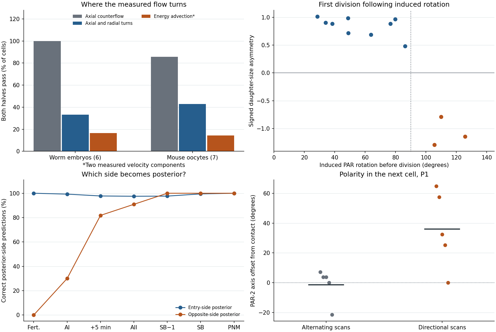
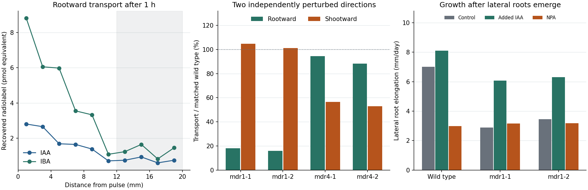

# 第14回研究報告　流れを変えると最初の分裂の向きは変わるか

2026-11-20 UTC、E49〜E54。**線虫の1細胞胚では、分裂前に流れを起こして極性の目印を回転させると、後の分裂で小さい娘細胞が生じる側を反転できた。** 目印の回転が90度未満だった9個はすべて元の向きで分裂し、90度を超えた3個はすべて逆の向きで分裂した。この結果は、先に起きた流れが後の身体の配置の一部に因果的に関わりうる、という仮説を支持する。受精卵には処置の前から卵殻と極性の目印がある。三次元のトーラス状エネルギー循環が身体の形成を先導するというH45については、同じ胚での経路と仕事の測定が残る。[介入の原著](https://doi.org/10.1038/s41556-017-0032-9)・[E52の個体別結果](../research/results/E52/summary.json)

根では、**標識オーキシンの輸送の向きと、形成済みの側根の伸びが結び付く**ことへの支持が強まった。単一分子が根端から外側を通って出発領域に戻る仮説（H44）は未判定。二方向に別々の供給点を置いた試験の結果は別々に記録した。[主張台帳](../research/claims.json)・[第13回との接続](22_MEASURED_RETURN_AND_POLARITY_REPORT.md)

## 1　後に生じる非対称性を流れで変えた二つの試験

Mittaschらは、最初の分裂前に線虫胚の細胞質へ流れを起こし、表層にあるPARタンパク質の領域を動かした。図5cの12個の中空の点をPDFの座標から読み、回転角を、同じ胚の分裂後の大小関係と照合した。無処置を表す黒点と著者が当てはめた曲線は採点から除いた。[図5の原著](https://doi.org/10.1038/s41556-017-0032-9)・[角度と大小関係](../research/results/E52/summary.json)

| 処置後、分裂前の極性の回転 | 元と同じ側に小さい細胞 | 反対側に小さい細胞 |
|---|---:|---:|
| 90度未満 | 9 | 0 |
| 90度超 | 0 | 3 |

初期の向きが保たれると常に予測した場合は9/12個、原著の90度の規則では12/12個が一致した。通常に分裂した最大の回転角は86.2度、反転した最小の回転角は105.6度で、その間の胚はなかった。したがって90度という境界の精密さはこの試料だけでは決まらない。反転群3/3個に対する二項95%区間は29.2〜100%。原著で知られた規則を同じ原図で再採点している。[採点前の登録](../research/registrations/E52-induced-flow-and-first-division.md)・[各閾値での的中数](../research/results/E52/summary.json)

Ngらは**最初の分裂が済んだ後の娘細胞P1**で、姉妹細胞との接触面を基準に極性がどちらを向くかを測った。約5分間、周縁を同じ向きに光走査して流れを起こす条件と、走査ごとに向きを反転して正味の流れを打ち消す対照を比較した。処置終了から約8.5分後のPAR-2軸のずれは、往復走査5個で平均−1.4度、一方向走査5個で+36.0度、差は**37.4度**だった。1個ずつ除いた10通りでも差は30.2〜46.3度。図に印刷された平均線とも0.05度以内で一致した。この時点でも、直前に生じた接触面だけでは極性は元へ戻らなかった。[Ngら、図5Gと方法](https://doi.org/10.1016/j.cub.2023.08.076)・[E54](../research/results/E54/summary.json)

P1の試験はミオシンに依存する流れを抑えられる温度感受性の系統で行われた。往復走査は光照射を伴う対照だが、両群が実際に吸収した熱量や細胞に伝わった機械的仕事は測定されていない。この図の終点はタンパク質の向き。最初の試験の終点は二つの娘細胞の大きさと位置である。[一次資料と対照の取り方](../research/notes/E49_E54_turning_paths_evidence.md)

## 2　自然な受精卵で、いつなら後端を予測できるか

Kimura・Kimuraは、受精時に入った精子の核と中心体の複合体が、極性が定まる前に細胞質の流れとともに移動する過程を撮影した。最終的に精子侵入側が後端になる場合と、反対側が後端になる場合がある。後者の稀な群を含め、**複合体がその時点でいた側を将来の後端と予測する**規則を、図4Bの位置分布から再計算した。各時期に何個の胚が写っているかも分母にした。[Kimura・Kimura、図2〜4](https://doi.org/10.1091/mbc.E20-01-0058)・[全7時期](../research/results/E53/summary.json)

| 観測時期 | 侵入側が後端だった群での誤予測 | 反対側が後端だった群での誤予測 | 両群の的中率を等しく重み付け |
|---|---:|---:|---:|
| 受精時 | 0/112 | 9/9 | 50.0% |
| 第1減数分裂後期 | 1/139 | 7/10 | 64.6% |
| その5分後 | 3/134 | 2/11 | 89.8% |
| 第2減数分裂後期 | 4/161 | 1/11 | 94.2% |
| 対称性が破れる1分前 | 4/170 | 0/10 | 98.8% |

第2減数分裂後期には、侵入側を常に選ぶと161/172個、複合体のいる側を選ぶと167/172個が的中した。二群を同じ重みで見ると50.0%から94.2%に上がる。精子侵入直後には後端の目印として失敗していた群で、流れが複合体を動かした後に予測が改善している。これは公表された同じ胚群の時期別の再集計で、各時期を別の独立試験とは数えない。最初の6時期はヒストグラムから復元した分母が原著の全12群の分母に一致した。最後の時期は小さな棒の個数の復元にずれがあり、原著記載の分母と、別パネルの誤予測率を照合した。[E53の読取りと誤差](../research/results/E53/summary.json)

別に報告された野生型試料では、反対側の後端化は自家受精3/84個、交配7/69個だった。流れを弱める二つの処置では0/20個、0/23個。どちらのゼロにも標本数に応じた幅があり、95%上限は16.8%と14.8%である。これらの数を位置予測の試料に足してはいない。上記の介入による反転と合わせると、自然に動く極性の目印と、人為的に動かした極性の目印のどちらにも後の配置との関係がある。[著者の原著](https://doi.org/10.1091/mbc.E20-01-0058)・[群別の区間](../research/results/E53/summary.json)

## 3　実測した流れはどこで折り返すか

前回は細胞の中央部で、軸に沿う流れが中心と外側で逆を向くことを確認した。今回はNiwayamaらの同じ13個体の計測ベクトルから、両端付近で中心軸に近づく速度と離れる速度を調べた。各個体を軸の両側に分け、**各側で「中央の軸流が内外で逆」「両端の径方向の流れも逆」がそろうこと**を基準にした。中央の対向流だけの基準より、折り返す経路を厳しく試せる。[Niwayamaらの実測配列](https://doi.org/10.1371/journal.pone.0159917.s004)・[E51の登録](../research/registrations/E51-meridional-turns.md)

| 同じ個体の両側で基準を満たした数 | 線虫の1細胞胚 | マウス卵母細胞 |
|---|---:|---:|
| 中央で軸流の向きが内外で逆 | 6/6 | 6/7 |
| 加えて両端で径方向の流れが逆 | **2/6** | **3/7** |
| 二つの測定速度成分から算出した運動エネルギーの移流でも両方が逆 | 1/6 | 1/7 |

半断面単位では両方向の条件が線虫7/12側、マウス10/14側でそろった。双方の側でそろった5個体では、皮質に沿う流れが出ていく端で外向き、集まる端で内向きだった。平均の取り方や端の窓を変えると、両側の流速条件を満たす個体数は線虫1〜2、マウス2〜3。四つの位置の平均から読み取れる折り返しは条件付きで支持できる。個別の粒子軌道や、未測定の角度方向に沿う動きはこの空間平均から確定できない。[各個体・各側の結果](../research/results/E51/summary.json)

エネルギーの行は、軸・径の速度で求める運動エネルギーを重みにして速度を平均した結果。速い部分の寄与が大きくなるため、単に平均した流速の符号からは決まらない。前回の三次元撮影の横断面に加え、二つの端の**両方の側**まで符号がそろう個体は限られた。全機械エネルギーには圧力と粘性応力による仕事が加わる。この表の2/13個を、生体内でトーラス状のエネルギー循環を検出した件数や、自然界における頻度に換算することはできない。[数式と符号の規約](../research/notes/E49_E54_turning_paths_evidence.md#二成分から得たエネルギーの範囲)・[前回の横断面](../research/results/E48/summary.json)

## 4　根のパルスが届く範囲と、根が伸びる段階

Rashotteらはシロイヌナズナの根端から20 mmの地点に標識したIAA（インドール酢酸）またはIBA（インドール酪酸）を10分間与え、非標識物質に替えて50分後に根端向きの10切片を測った。供給点から8〜10 mmのIAA標識は約1.38 pmol相当、原著が背景域とした12〜20 mmの4区画平均は0.76。IBAはそれぞれ3.33と1.29だった。原著が述べる先端の移動距離は1時間で8〜10 mmである。図にある時刻は一つで、経路の途中での到着時刻は測れない。根端への持続投与をした別試料では5時間後に、地上部側の1〜3、3〜5、5〜7 mmでIAA標識が1.93、0.78、0.17 pmol相当まで低下した。[Rashotteら、図3・表I](https://doi.org/10.1104/pp.103.022582)・[E49](../research/results/E49/summary.json)

Lewisらの一次根の試験では、二方向の輸送を異なる遺伝子変異で弱めた。各方向で、同じ遺伝的背景の野生型を100%として、図のすべての対立遺伝子を読み取った。[Lewisら、図2A・D](https://doi.org/10.1105/tpc.107.051599)・[E50](../research/results/E50/summary.json)

| 系統 | 根端向きの標識輸送 | 地上部向きの標識輸送 |
|---|---:|---:|
| mdr1-1 / mdr1-2 | 18% / 16% | 105% / 101% |
| mdr4-1 / mdr4-2 | 94% / 88% | 57% / 53% |

同じ研究グループのWuらは、側根そのものの基部から先端へ届く標識も測った。mdr1の2系統では野生型基準の約38%、40%、正常なMDR1を戻した群で約83%だった。出現済みの側根の伸びは野生型7.01 mm/日に対して2.89、3.46 mm/日で、外部IAAを与えると6.07、6.31 mm/日まで回復した。一方、8日目に数えた原基と出現側根の合計は同じ背景の野生型の90%、98%で、原著は開始数の有意差を報告していない。側根の伸長に必要な供給の一部は外から補える。新しい側根を作り始めることに、同じ分子の一周が必要かは、この測定では判定できない。[Wuら、表1・図8・9](https://doi.org/10.1105/tpc.106.048777)・[測定した各段階](../research/results/E50/summary.json)

## 二つの未判定に残った識別点

**根での一周。** 二方向の経路を別々に弱められる条件と、標識が背景を超えて読める距離が具体的になった。次に必要な観測は、同じ根の内側から出た天然IAAが、根端と外側を通った履歴を持ち、内側の出発領域に遊離IAAとして初めて戻る割合である。細胞の一部で光を当ててIAAを放出する実例があり、出発場所を定める段階には足掛かりがある。その割合と、外部供給だけを戻して成長が回復する場合の割合を比べれば、「伸長にIAAが必要」と「伸長に同じ分子の一周が必要」を見分けられる。[局所でIAAを放出した原著](https://doi.org/10.1002/cbic.200900289)・[経路を識別する条件](../research/results/E40/summary.json)・[化学形の照合](../research/results/E45/summary.json)

**形成に先立つ三次元エネルギー循環。** 今回、初回分裂で大小どちらの娘細胞がどこにできるかを、先行する流れで変えられる例が得られた。H45をさらに動かすには、その同じ胚で分裂前の全三次元速度と圧力・応力による仕事を測り、同程度の仕事を別の経路に与えた場合と、分裂の向きを独立な胚で比較する必要がある。今回のE51、E52、E53、E54には、異なる個体・段階・介入が含まれる。それらを一つの胚の因果経路としてつなぐことはできない。[文献と未測定量](../research/notes/E49_E54_turning_paths_evidence.md)・[再開記録](../research/STATUS.md)

図表の採点基準、入力資料、解析コード、読取りの限界、全数値と再実行手順を保存した。[資料取得と再実行](../research/access/2026-11-20-turning-paths.md)・[実行ログ](../research/results/TURNING_PATH_RUN.json)
