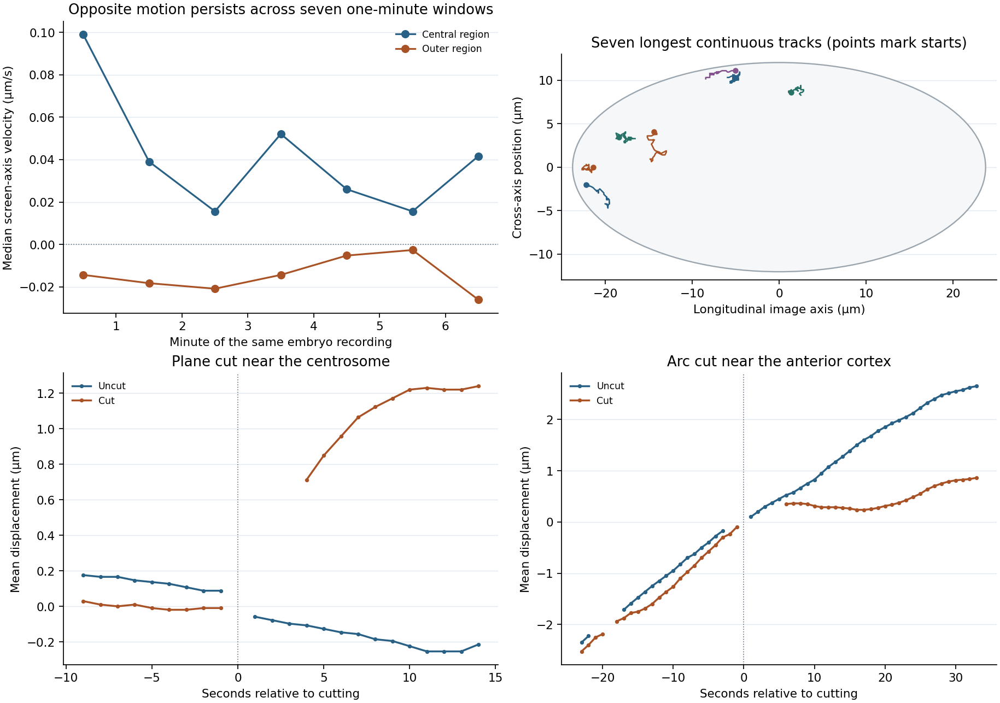
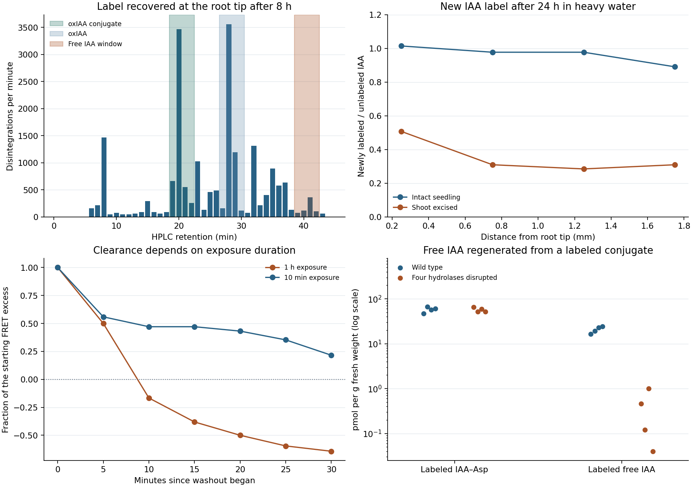

# 第15回研究報告　顆粒の帰路と、根の標識が示す化学形

2026-11-20 UTC、E55〜E60。**分裂前の線虫胚の同じ動画で、中心と外側の顆粒が逆方向へ動くことを7分間にわたって確かめた。** 一つの顆粒を連続して追えた時間は長くても110秒で、識別できる一周は得られなかった。根では、切り口から与えたオーキシン（IAA）由来の標識を先端まで追うと、遊離IAAに相当する位置の信号は、表示された放射能の約3.3%だった。さらに、別の標識実験で、IAAの抱合体から標識付きの遊離IAAが生じることを再集計した。[動画の採点](../research/results/E58/summary.json)・[根端での化学分離](../research/results/E55/summary.json)・[抱合体からの再生成](../research/results/E60/summary.json)

## 胚で同じ顆粒をどこまで追えたか

NiwayamaらのS1 Movieは、一つの線虫胚を2秒間隔で424秒間撮った光学像で、蛍光を付けた卵黄顆粒が映っている。10 µmの尺は64画素だった。画像の輝点を隣り合うフレームで対応させ、逆方向の追跡誤差と見え方の相関を確認した。同じ輝点に二本の軌跡が合流した場合や、輝点が消えた場合はそこで追跡を切った。位置が再び近づいても途中の欠測をつないでいない。[原著のS1 Movie](https://doi.org/10.1371/journal.pone.0159917.s006)・[判定条件](../research/registrations/E58-granule-paths.md)

12秒ずつの短い区間の長軸速度を、動画内の1分ごとに集計した。**採点できた7区間すべてで、中心の中央値は画面右向き、外側は左向き**だった。中心は+0.016〜+0.099 µm/秒、外側は−0.026〜−0.003 µm/秒。早い区間も遅い区間も二方向の動きが同時に見える。これは一つの胚での時間方向の繰り返しで、7個の独立な胚を意味しない。小さい流速の値は画素単位の分解能にも影響される。[全区間の速度と分母](../research/results/E58/summary.json)

一周の判定は、連続60秒以上、最初の場所から5 µm以上離れる、経路長14 µm以上、出発点の1 µm内に戻り、囲む面積5 µm²以上などを同時に求めた。開始した9,927本の候補には再検出や短時間で見失った輝点を含む。60秒以上残ったのは27本、最長110秒で、その27本のうち出発点から5 µmに達した軌跡は0本だった。長軸に3 µm進んで戻り、短軸方向に1.5 µm以上離れるという折り返し条件も満たさなかった。合成画像では円軌道8本を一周と判定し、真っすぐ戻る往復と、途中で見えなくなった円軌道では0本だった。実映像では一周の採点に足る長さの観測が得られず、一周の有無を判定できない。三次元撮影に由来する別のS3 Movieからも、同じ顆粒の三次元座標を時系列で取得できなかった。[合成対照と感度分析](../research/results/E58/summary.json)・[S3 Movie](https://doi.org/10.1371/journal.pone.0159917.s008)

## 極性を作る流れと、運動が作る流れ

第14回には、別の線虫胚実験で、流れによって既存の極性を分裂前に回すと、後で小さい娘細胞が現れる側を反転できることを確認した。今回はWuらの微小管切断試験を読み直し、卵の中の構造の運動が先にあり、周囲の流れを作る場合も比較した。[第14回の介入](23_TURNING_PATHS_AND_AXIS_REPORT.md)・[Wuらの原著](https://doi.org/10.1038/s41567-023-02223-z)

| 初回分裂前の測定 | 無切断の平均 | 切断後の平均 | 切断群と無切断群の差 |
|---|---:|---:|---:|
| 前核・中心体の近くで平面切断。12秒後の切断面から遠ざかる方向 | −0.25 µm | +1.22 µm | +1.47 µm |
| 前側の細胞表層に沿って弧状に切断。30秒後の前核複合体の前進 | +2.55 µm | +0.81 µm | −1.74 µm |

弧状切断の6〜20秒後の平均曲線の傾きは、無切断約0.100 µm/秒、切断後約−0.007 µm/秒で、当初の前進が弱まった。平面切断は各48件の変位データ、弧状切断は無切断14胚と切断19胚。二つの試験は変位の基準軸が違う。原著が8胚の蛍光ナノダイヤモンドの動きから求めた局所的な回り込みは、細胞表層が微小管を引き、その力で動く前核が周囲の流体を動かすモデルにも現れた。形や配置に作用する流れと、配置を変える力の結果として生じる流れは、切断の位置や時間順を調べて見分けられる。[Wuら図5](https://doi.org/10.1038/s41567-023-02223-z)・[再集計](../research/results/E59/summary.json)

## 根で到着した標識は何に変わっていたか

Pěnčíkらはシロイヌナズナの地上部を切り離し、根側の切断面に¹⁴C標識IAAを与え、8時間後に先端約5 mmを採取した。HPLCで分けた画分から、表示された全放射能を分母として読んだ。酸化されたoxIAAの時間帯が25.5%、その糖抱合体の時間帯が25.1%、遊離IAAに対応する39〜42分の時間帯が3.29%。最後の窓を前後1分ずらすと3.21〜3.43%だった。窓内には未同定の信号も入りうる。図上に表示された分母であり、根に与えた総量からの回収率や、根の外層を通った割合は分からない。別の無傷苗のLC–MS/MS測定では、5.5時間のIAA処置により根端のoxIAAが約227から523 fmol/試料に増えた。[Pěnčíkら図5・6](https://doi.org/10.1105/tpc.113.114421)・[画分ごとの放射能](../research/results/E55/summary.json)

根が作るIAAもある。Ljungらは発芽後7日に地上部を残す群と切り離す群を用意し、重水中の24時間で新しく標識されたIAAを質量分析で測った。先端0〜0.5 mmの標識体／非標識体の比は無傷苗で約1.01、根のみでも約0.51。全IAA量は1.52と0.75 pg/mmだった。根のみの群では、先端の比は隣接3区間の平均の約1.68倍だった。地上部がない条件で根の系に新生IAAがあることを支持する。切断後に根の中で起きる輸送や代謝の変化が含まれるため、無傷苗のどの割合が地上部由来かはこの差から決まらない。[Ljungら図4](https://doi.org/10.1105/tpc.104.029272)・[細胞型別のPeterssonらの測定](https://doi.org/10.1105/tpc.109.066480)・[抽出値](../research/results/E56/summary.json)

**遊離IAAは抱合体から再生成できる。** Hayashiらの公開ワークブックで、重水素を付けたIAA–Aspのエステルを投与して6時間後の値を集計した。標識IAA–Aspは野生型57.6、加水分解に関わる四つの遺伝子を欠く系統57.0 pmol/g新鮮重量。標識付きの遊離IAAは20.62から0.405 pmol/gへ低下し、変異株では野生型の約2.0%だった。各群4標本で、野生型16.44〜24.14、変異株0.04〜1.00 pmol/gと全点で離れていた。遊離型と抱合型を合わせた群平均に占める遊離型は26.4%と0.71%。回収時に元と同じ遊離型や同位体標識であっても、途中に抱合体を経た可能性を調べる必要がある。この例の入力は標識された抱合体のエステルで、根の経路や天然状態での再遊離率は測定していない。[Hayashiら図3bとSource Data](https://doi.org/10.1038/s41467-021-27020-1)・[個体別数値](../research/results/E60/summary.json)

## 濃度の信号は戻るが、同じ物質の帰還とはまだ結び付かない

Herud-SikimićらのIAAに結合するセンサーAuxSenで、根の外からIAAを与えた後の変化を読み直した。外部IAAの除去直後の基線からの上昇分を1とすると、洗出し10分後、10分投与群（5株）の上昇分は約47%残り、1時間投与群（3株）の値は投与前の基線を下回った。別実験では根を135度傾けた1分後に下側と上側のFRET比の差が+0.073、元に戻して1分後は−0.168で、差の向きが入れ替わった。標識のないIAAの位置や量が短時間で変わることを示す観測で、補給、輸送、分解を別々に定量するには他の測定が必要である。[AuxSenの原著図3h・4d](https://doi.org/10.1038/s41586-021-03425-2)・[洗出しと傾斜の全時点](../research/results/E57/summary.json)

## 二つの仮説の現在地

- **同じIAAの根での一周（H44）。** 根端へ標識が届くこと、化学形が途中のどこかで変わりうること、地上部がなくても根がIAAを作れることに実測の根拠がある。一周を判定するには、内側の出発位置、根端と外層の通過、出発領域への最初の帰還を同じ標識で対応させる。遊離IAAに加えて、酸化型や加水分解で遊離しうる抱合型を経路上で測れば、到着時の化学形に加えて途中の変換を評価できる。[経路を識別する条件](../research/results/E40/summary.json)・[今回の化学形の対照](../research/results/E60/summary.json)
- **身体形成に先立つトーラス状エネルギー循環（H45）。** 分裂前の対向流が続くことと、別の介入で分裂の向きが変わることは支持できる。前核が動いて流れを作る場合もある。初回分裂を対象に閉じた三次元軌道と因果を調べるには、同じ胚の体積時系列で一周に足る長さの連続した座標、圧力と粘性がした仕事、同程度の仕事を異なる流路に与えたときの娘細胞の配置が必要である。[主張台帳](../research/claims.json)・[次回の再開記録](../research/STATUS.md)

[一次資料と測定の限界](../research/notes/E55_E60_particle_return_evidence.md)・[数値と図の再実行](../research/access/2026-11-20-particle-return.md)
