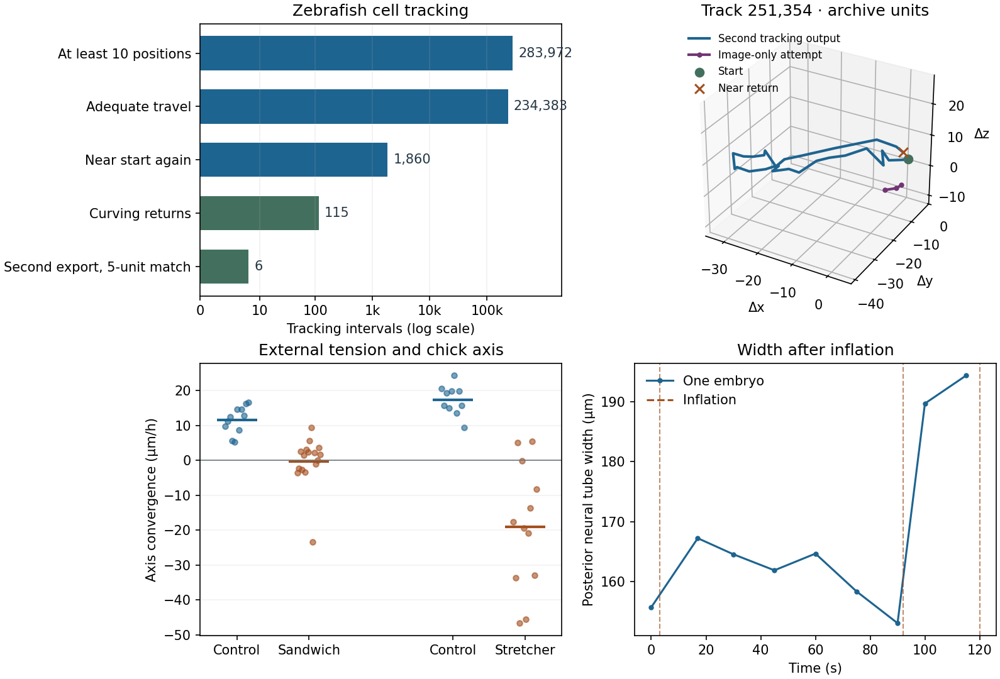
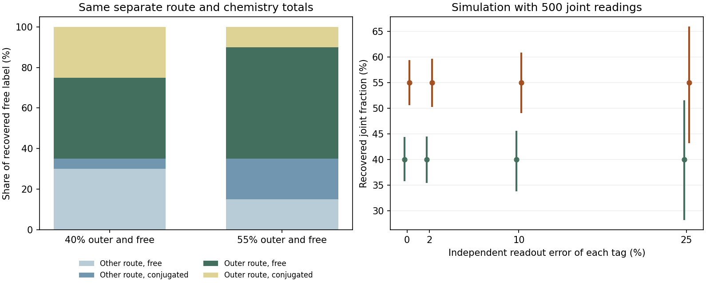

# 第16回研究報告　胚の三次元の帰還候補と根の二つの履歴

2026-11-20 UTC、E61〜E66。**ゼブラフィッシュ1胚の三次元座標から、同じ追跡IDで出発点の近くまで回り込んだ候補が115本見つかった。** 同じ撮影をもとにした別の追跡版でも、照合距離を広げた条件で6本が基準を満たした。最も大きく動いた候補を画像から追い直すと31時点中3時点で途切れ、同じ核が一周したかは未判定だった。別のニワトリ胚の実験では、胚の外側の張力を先に変えると、その後の体軸の成長が変わることを確認した。根では、同じ標識の遊離IAAのうち、外層を通り、途中で抱合されなかったものの割合をどこまで推定できるか数式と計算で求めた。[追跡候補](../research/results/E62/summary.json)・[照合](../research/results/E65/summary.json)・[画像からの追跡](../research/results/E66/summary.json)・[張力](../research/results/E63/summary.json)・[根の標識](../research/results/E64/summary.json)

## 一つの細胞が三次元で出発点の近くまで戻るか

Biohubが公開するゼブラフィッシュ1胚、522時点の追跡から、各細胞核の座標が連続して記録された区間を取り出した。分裂による異なるIDの結合や、見失った時点の補間はしていない。Shahらの別の可視化にある11,120本については、原著で短い軌跡を統計的な速度場でつなぐ手順が使われ、ビューアの original が一個の核の連続観測だと確かめられなかったため、この分母から外した。[E62の登録](../research/registrations/E62-volumetric-cell-first-returns.md)・[Biohubの配布](https://virtual-embryo-zoo.sf.czbiohub.org/dataset/danior)・[Shahら](https://doi.org/10.1038/s41467-019-13625-0)

| 検査したこと | 区間数 |
|---|---:|
| 配布された追跡ID | 398,662 |
| 連続10時点以上 | 283,972 |
| 出発点から約20.43以上離れ、経路長が約51.07以上 | 234,383 |
| その後、出発点の約5.11以内に戻った | 1,860 |
| 一歩が極端に大きい候補を除き、角度と軌道の広がりを含む基準に合った | 115 |

距離は配布座標の単位。帰還半径を半分にすると20本、倍にすると530本だった。傾けた円を使うと通り、直線往復、270度で切った円、半円、平面上では戻るが奥行きがずれるらせんはいずれも基準から外れた。同じ胚の中に多くの軌跡が含まれるため、分母から他の胚や発生全体の頻度は推定できない。一つの近い帰還で、面を成す流れやトーラスの存在は判定できない。[全条件と候補一覧](../research/results/E62/summary.json)・[候補TSV](../research/results/E62/candidate_returns.tsv)

**別の追跡版で再現した6本。** Bragantiniらの論文に付属する追跡版とBiohubの追跡版の時間と場所をまず照合した。12時点の同時刻では三次元座標が各1,404〜2,640点で完全一致し、10時点前後の対照では最大21点だった。別の追跡版で、候補の全時点で最寄り検出が5単位以内かつ2番目に近い検出がさらに1単位以上離れた条件では22本が残った。そのうち15本は別版でも全時点で同じID、6本は軌道を再採点しても回り込んで戻る基準に合った。距離3以内かつ次点との差が2以上の厳しい条件では0本。時刻を30時点ずらした対照は、検査できた113本・105本で0本だった。二つの追跡版は同じ測定のため、別胚での再現や、手動で確認された赤チャネルの枝との対応は未測定である。[E65の結果と全分母](../research/results/E65/summary.json)・[Bragantiniらの原著 図4](https://doi.org/10.1038/s41592-025-02778-0)

**体積画像では一周の確認に届かなかった。** 6本の中で最も遠くまで動いた候補を選んだ。別版では出発点から51.63まで離れ、31時点目に5.00離れた位置へ戻った。公開の体積画像を読み、開始座標だけを渡して、以後は近傍の蛍光の明るい核を毎時点選んだ。最初の3時点は追跡版の座標から約7.87〜8.90離れた位置で、4時点目で途切れた。予測位置の探索距離を18、22、26と変えても同じだった。画像の軸方向のサンプリング間隔は16配布単位で、軌道判定の帰還半径約5.11より粗い。今回の画像法では、同じ核の同定と一周の有無を決められない。[画像から追い直した結果](../research/results/E66/summary.json)・[事前に固定した方法](../research/registrations/E66-image-only-track.md)

## 身体の形より先に作用する力と、形を決める条件

Asaiらのニワトリ胚では、前方にVg1を発現させる細胞を移植すると、元の原条が伸びる前に、反対向きの渦の組が移植側で優勢になった。処置した4胚で、元の原条はそれでも元の正中に沿って伸びた。分裂を抑えた条件では、本来の原条と異所の原条の伸長が弱まる一方で、移植側の渦が確認された（各群3胚の流れを観察）。Wnt/PCP経路の抑制でも原条は短く幅広くなり、左右の回転は残った（流れの観察は各群5胚）。この条件の表面の渦の有無や向きだけで、原条の正常な伸長を決めるという説明には反例がある。表面像の流線や局所の回転の色からは、三次元体積の閉じた循環を判定できない。[Asaiらの原著 図1〜4](https://doi.org/10.7554/eLife.89948.3)・[比較と要約値の再計算](../research/results/E61/summary.json)

左右の渦中心間の平均距離は原著の図1補足1Iで860.2 µmと1,008.4 µm（各4胚）。表示のばらつきを標本標準偏差とすると、両側の等分散t検定は $p=0.195$ で、図の $p=0.026$ と一致しない。図には棒と誤差線のみがあり、公開されたベクトル図から各個体の値を再構成できなかった。距離差の有意性は原データか誤差線の定義が確認できるまで保留した。形と流れの観察はこの距離のp値に依存しない。[原著図1の補足](https://pmc.ncbi.nlm.nih.gov/articles/PMC11087055/#fig1s1)・[計算と丸め幅](../research/results/E61/summary.json)

**胚の外側の張力は、その後の体軸を変える。** Kunzらはニワトリ胚を取り巻く卵黄膜の張力を変えた。通常なら細くなって伸びる後部体軸が、高い張力を保つ条件で収束しにくくなった。別の装置で外から膜を引いた場合も、後部神経管が広がる向きへ平均速度が反転した。図3の速度の集計は破れなかった胚に限られる。約6時間以内の軸の破裂は高張力群11/37、対照0/20だった。[Kunzらの原著 図3・4および表1](https://doi.org/10.1038/s41467-023-38988-3)・[胚ごとの再集計](../research/results/E63/summary.json)

| 処置と測定 | 対照平均 | 処置平均 | 処置と対照の差と標本再抽出95%区間 |
|---|---:|---:|---:|
| 張力を維持、6〜8時間後の収束 | +11.60 | −0.29 | −11.90［−16.29, −8.15］ |
| 同じ処置、後部の伸長 | +107.59 | +44.39 | −63.21［−88.67, −37.07］ |
| 別装置で外部から伸張、約3時間の収束 | +17.28 | −19.06 | −36.34［−46.48, −26.62］ |

速度は µm/時。負の収束速度は幅が広がる方向。フィルターを使った処置の速度は対照11胚・処置16胚。伸張装置の処置群は12胚。図の説明では対照9胚、公開表には10値があり、その平均は公開表の平均と一致した。どの対照値を1件除いても、収束速度の差は−37.22〜−35.57 µm/時だった。また別の胚の2回目の膨張では、92秒の処置を挟んで幅が153.11 µm（90秒）から189.69 µm（100秒）になった。[公開表からの感度分析と形の時系列](../research/results/E63/summary.json)

**張力を変える装置の仕事をどこまで数値にできたか。** 卵黄膜を同じ速さで押した別試料の力の増加率は、培養開始日の0.166 mN/秒から2日目の0.0569 mN/秒になった。2日目まで高張力を維持した群では0.102 mN/秒。押し込む速さ0.1 mm/秒で割ると、力と変位の勾配はそれぞれ1.66、0.569、1.02 N/mとなる。20秒の線形近似区間で、始点の力を基準に増えた力の分だけを積分すると、平均の増分仕事は3.32、1.14、2.03 µJだった。これは装置が別の膜試料に加えた力の勾配からの換算で、元の力–変位曲線や、胚の形を変えた介入そのものの仕事は公開表にない。形の時間順と、体内の機械エネルギーの流れる経路は、同じ胚での速度と圧力・応力が必要になる。[原著 図1hと測定方法](https://doi.org/10.1038/s41467-023-38988-3)・[単位と群データ](../research/results/E63/summary.json)

## 根で「同じIAAが一周した」を判定する

前回の公開測定では、標識を付けた抱合体から同じ標識の遊離IAAが生じた。「根端と外層を経た同じ標識が内側へ帰った」と「その標識を持つIAAが途中ずっと遊離だった」は、別々に判定できる。今回の模型では、内側の出発領域で最初の帰還が確認され、回収時に標識付き遊離IAAとして同定された集団を分母にした。根端と外層の通過に対応する割合を $r$、過去に抱合があった割合を $c$ とする。通過した遊離のままの割合の上下限は $[\max(0,r-c),\min(r,1-c)]$ で、双方の端を実現する四群の構成を線形計画で確認できた。[前回の原著再集計](../research/results/E60/summary.json)・[E64の模型と対照](../research/results/E64/summary.json)

経路と化学形を別々に集計して両方50%なら、外層を通り遊離のまま戻った割合は0〜50%まで可能。経路65%・過去に抱合30%が同じ母集団で測れていれば、その割合は35〜65%で、下限が正になる。二つの履歴を同じ回収物で読み、各読み取りの独立な対称誤差を仮定すると、その誤差が10%ずつの模型で、500件の同時読み取りは、真の割合40%と55%の場合をそれぞれ33.8〜45.6%と49.1〜60.9%の中央95%区間に分けた。誤差25%ずつでは同じ件数の区間が重なった。ここでの件数、割合、誤差は模型に設定した値で、根からの実測には経路の印、標識の交換、未知の化学変換、測定誤りの校正が要る。[E64の乱数と全条件](../research/results/E64/summary.json)・[履歴の登録](../research/registrations/E64-joint-root-tracer-history.md)

## 二つの仮説の現在地

- **同一の天然IAAの一周（H44）は未判定。** まず標識が出発地点に残った分を除き、根端から外層を経たものが内側へ最初に戻る割合を、標識の組み替えや内側だけの経路を調べた対照と比較する。遊離のままの一周を問う場合は、抱合履歴と経路を結び付けるか、同じ回収集団で最も保守的な下限を求める。[E40の経路の対照](../research/results/E40/summary.json)・[E64の識別限界](../research/results/E64/summary.json)
- **形を先導する三次元トーラス状エネルギー循環（H45）は未判定。** 先行する機械的な力で後の形が変わる部分を、胚組織の成長スケールでも支持できる。閉じたエネルギー循環の固有の効果には、同じ胚・同じ部位での時間順、三次元の速度と圧力・応力による機械仕事、閉路を選択的に変えた介入と入力仕事をそろえた対照が要る。流れによる運動エネルギーの移流と、圧力や応力が境界を介して伝える仕事を合わせて測る。個々の核の軌跡と体積中の仕事の分布を対応させるため、連続した体積での標識追跡を優先する。[機械仕事の既存の計算](../research/results/E14/flow64/summary.json)・[主張台帳](../research/claims.json)・[再開地点](../research/STATUS.md)

[一次資料の届いた範囲](../research/notes/E61_E66_embryo_history_evidence.md)・[取得と再実行](../research/access/2026-11-20-embryo-history.md)
