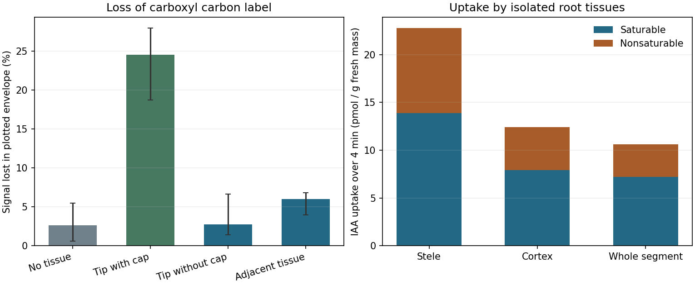
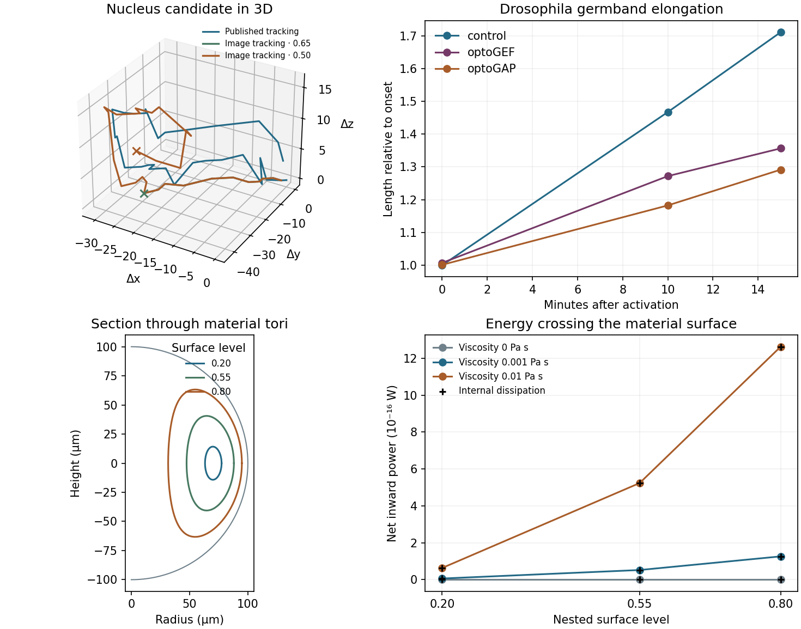

# 第17回研究報告　根へのIAAの再取り込みと、胚の形を変える機械仕事

2026-11-20 UTC、E67〜E71。**トウモロコシの根片で、外へ出たIAA由来の標識の一部が根片に再び入る条件を確認した。** 別の試験では、取り込まれた標識の約92%がIAA標準と同じ位置に出た。根端と外層を経た同一の天然IAAが内側の出発地点に一周して戻ったかは未判定。発生側では、ショウジョウバエ胚でミオシンの制御を変えると後の体軸伸長が変わることを確認した。力学計算では、**粒子が同じトーラス状の経路を巡るときも、粘性応力による仕事がその面を横切る**ことを確かめた。[根片での再取り込み](../research/results/E68/summary.json)・[取り込んだ標識の化学形](../research/results/E71/summary.json)・[体軸への介入](../research/results/E69/summary.json)・[機械仕事の計算](../research/results/E70/summary.json)

## 根に再び入ったのは何か

Wilkinsのトウモロコシ根片の試験では、基部側に与えた標識IAA由来の放射能が、先端側の外に置いた受け側へ移った。25 °Cでは6〜8時間後から、受け側を根に接触させたままにすると放射能が減り、8時間で取り外した対照ではほとんど減らなかった。原著は、根片への正味の再取り込みが生じ、戻った標識の大部分が先端側の2〜4 mmに残ったと報告している。10 °Cでは受け側への正味の移動が少なくとも50時間続いた。ここは公開抄録で確認した結果。再取り込みの前後で遊離IAAを直接同定した結果や、根の内外の組織を通った順番は得られなかった。[Wilkinsの原著抄録](https://doi.org/10.1007/BF00384767)・[出典と測定条件](../research/results/E68/summary.json)

別のトウモロコシ根片の試験を読み直すと、**4分後の根の抽出物では、標識の約92%が遊離IAA標準と同じ位置に現れた。** 小さいピークの割合は投与液で3%、根片の抽出物で8%。根片から抽出できた放射能99.5%は、ピークの割合とは別の測定である。中心柱と皮層を分けた試験では、単位生重量当たりの4分の取り込みは中心柱22.8、皮層12.4 pmol/gで、比は1.84。1切片当たりにすると、中心柱0.0251、皮層0.0553 pmolで、比は0.45だった。両組織の量と切断面が異なるため、無傷根の中でどちらへどの程度流れるかはこの比較から決まらない。[Martin・Piletの原著 図4・表I](https://pmc.ncbi.nlm.nih.gov/articles/PMC1075445/)・[分母を比べた計算](../research/results/E71/summary.json)

## 根端は標識の収支を変える

Kerkらは、トウモロコシの根の基部側から、カルボキシル炭素を¹⁴Cで標識したIAAと、環の位置を³Hで標識したIAAを供給した。12時間後に先端などを分け、HPLCの各画分の両標識を比較した。原著図8の黒い領域は観測された¹⁴C、外側の輪郭は、³Hを基準に脱炭酸がなかった場合の¹⁴Cを換算した分布。図の面積を共通の方法で読むと、両者の差が最も大きかったのは、根冠を残した先端1 mmだった。[Kerkらの原著 図8](https://doi.org/10.1104/pp.122.3.925)・[読取りと対照](../research/results/E68/summary.json)

| 図8の条件 | 換算側の面積に対する¹⁴Cの不足 | 図の判定条件を変えた範囲 |
|---|---:|---:|
| 組織なし | 2.6% | 0.6〜5.5% |
| 根冠を残した先端1 mm | 24.5% | 18.7〜28.0% |
| 根冠を除いた先端1 mm | 2.8% | 1.4〜6.6% |
| 先端に隣接する根の区画 | 6.0% | 4.0〜6.8% |

原著本文は脱炭酸を「少なくとも30%」と報告する。今回の値は図の塗りと輪郭をピクセルで分けた近似で、個々の画分の元のカウントがないため30%は再現できなかった。根冠を残した先端で差が大きくなる結果は、読取り条件を変えても残った。組織なしの小さい差も読み取りの限界を示す。いずれも図に表示された分母で、根に与えた量や一周の途中で失われた天然IAAの割合には換算できない。[図8と原著本文の比較](../research/notes/E67_E71_iaa_embryo_work_evidence.md)・[全条件の数値](../research/results/E68/summary.json)

## 三次元画像で同じ核の帰還を追う

前回に二つの追跡データで近い軌跡が得られたゼブラフィッシュの候補6本のうち、最も遠くまで動いた1本を対象にした。同じ撮影のレベル1の体積像を31時点取得した。前回比でXY・Z方向とも画素間隔は半分。前向きには開始座標、逆向きには終了座標だけを渡し、途中は画像上の明るさの分布を使って追った。既知の動きを与えた合成像は全時点を追い、像を失った対照では欠測をまたがなかった。[画像の原著](https://doi.org/10.1038/s41592-025-02778-0)・[登録と合成対照](../research/registrations/E67-half-resolution-nuclear-track.md)・[追跡の結果](../research/results/E67/summary.json)

- 主条件の相関0.65では、前向きに13時点、逆向きに3時点まで続いた。前向き13位置の公表座標との差の中央値は4.0配布座標単位。前回と同じ輝点だけの方法は、解像度を上げても3時点だった。
- 相関0.50では前向きに31時点まで続いた。公表座標の16単位以内に入ったのは26/31時点で、事前に求めた90%を下回った。最後は画像上の出発位置から40.8単位離れ、倍の帰還半径約10.2でも帰還条件に入らなかった。
- 公表座標が分かっている状態で周囲の輝点を調べても、一部の時点では最寄りが約20〜35単位離れた。画素の見え方や近くを通る核、追跡の誤りをこの1チャネルだけから区別できない。同じ核の独立した一周の確認は保留した。[前後方向と各閾値の出力](../research/results/E67/summary.json)

## 体軸の伸長に先立つ介入と、エネルギーの経路

ショウジョウバエ胚の胚帯が伸び始める時点で、局所のミオシン制御を光で変えた公表実験を再集計した。細胞の中央周辺でミオシンを増やす条件では、光を当てて1分後の強度が平均+22%、対照+3%。15分後の胚帯の長さは、開始時を1にそろえると以下の値だった。光を当てた対照群と比べ、ミオシンを抑制する条件の差に原著の統計的な支持がある。増加させた方も平均の方向は同じで、原著は両側の比較で $p=0.06$ と報告した。[Herrera-Perezらの原著 図1・4](https://doi.org/10.1103/PRXLife.1.013004)・[図版の再集計](../research/results/E69/summary.json)

| 条件 | 15分後の長さの比、図の再集計 | 原著本文の平均 ± 標準誤差 |
|---|---:|---:|
| 対照 | 1.71 | 1.71 ± 0.09 |
| optoGEF、ミオシン制御を増加 | 1.36 | 1.37 ± 0.09 |
| optoGAP、ミオシン制御を抑制 | 1.29 | 1.29 ± 0.05 |

これは胚帯の伸長の開始と同時に介入し、その後の形を測った試験。レーザー切断後の速さは、切断前の張力と組織の粘性による抵抗の両方に依存するため、これだけで仕事やエネルギーをジュールに換算できない。体の形ができる前から閉じた三次元の機械エネルギー流束があったかも、この測定からは分からない。[実験時刻と単位](../research/notes/E67_E71_iaa_embryo_work_evidence.md)・[原著本文との照合](../research/results/E69/summary.json)

**粘性があると、機械エネルギーはトーラス状の物質面を横切り得る。** 球の内部で、外へ出ずに回る粒子の経路を与えた。粘性を0、0.001、0.01 Pa sにしても同じ速度を満たすよう圧力を計算し、物質が横切らない三つのトーラスの面を通るエネルギーを積分した。中央の面で、粘性0のときの正味流入は計算精度の範囲で0 W。粘性0.001 Pa sでは5.24×10⁻¹⁷ Wが正味で入り、内部の散逸と一致した。0.01 Pa sではその10倍。粘性がある条件の流入は応力が面を介して行う仕事から生じ、物質の移流と圧力の法線方向の仕事は0だった。[E70の全条件](../research/results/E70/summary.json)・[境界条件と判定](../research/registrations/E70-energy-across-material-tori.md)

定常の場合には、体積の中の駆動による仕事、境界を横切るエネルギー、散逸が釣り合う。この計算では内部に体積力を置かず、球面で接線速度を与えた。流体の密度・大きさ・粘性は設定値で、胚の測定値には換算しない。胚で体積内部の駆動や蓄積がある場合は、それも収支に加える必要がある。もし三次元の閉路が形を作るなら、粒子の一周に加えて応力の仕事を測ることで、機械エネルギーがどこを通って循環するかを判定できる。[力学の式と限界](../research/notes/E67_E71_iaa_embryo_work_evidence.md#e70-物質を通さない面に入るエネルギー)

## 二つの仮説の判定

- **同一の天然IAAが根を一周する（H44）**。根片への標識の再取り込みと、短時間に取り込まれた標識の主要な化学形が遊離IAAと整合することを別々の実測で支持できる。同一の天然IAAを無傷根の内側で識別し、根端と外層を通って、残留とは区別できる最初の帰還を確認する試験が残る。途中の化学変換も問う場合は、構造の異なる位置の標識や抱合・酸化の履歴を経路の測定と対応させる。[根の履歴の数理的な条件](../research/results/E64/summary.json)・[H44](../research/claims.json)
- **三次元トーラス状エネルギー循環が身体形成を先導する（H45）**。先行する外部張力と、伸長開始時のミオシン制御が後の形に作用するという範囲を支持できる。三次元の流束が閉じる試験には、同じ発生段階で同じ胚の速度と応力、内部での駆動、散逸を対応させる。形への因果は、その閉路を変え、入力仕事を照合した対照と後の形を比べて判定する。[第16回の張力の実測](25_EMBRYO_RETURNS_AND_ROOT_LABELS_REPORT.md)・[H45と再開点](../research/STATUS.md)

[一次資料の確認範囲](../research/notes/E67_E71_iaa_embryo_work_evidence.md)・[原本の再取得と計算](../research/access/2026-11-20-iaa-embryo-work.md)
