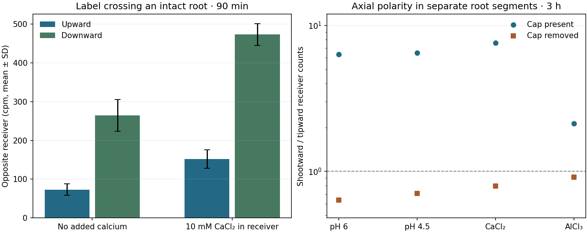
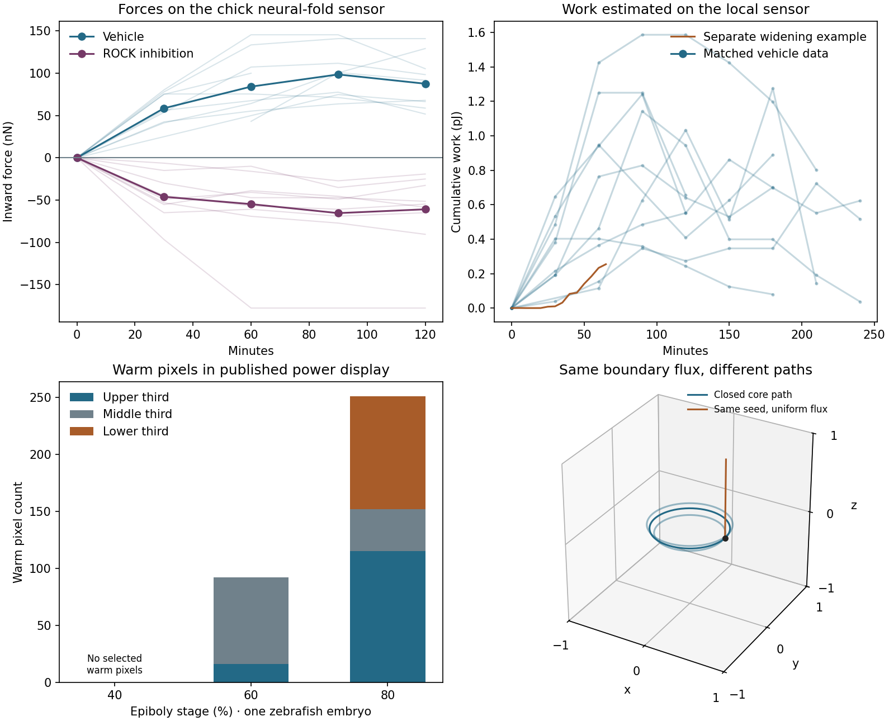

# 第18回研究報告　根を横切るIAAと、胚の形が変わるときの機械仕事

2026-11-20 UTCにE72〜E76を実行した。**無傷のトウモロコシ根で、片側から反対側に届いた標識の一部がIAAとして回収されることを支持する化学測定があった。** 同じ品種の別の実験では、根冠があるかどうかによって軸方向の輸送の偏りが逆転した。発生側では、**ニワトリの神経管が閉じる途中で、局所にかかる力の向きがROCK阻害で逆転し、両条件でセンサーに仕事が蓄えられた。** 同一の天然IAAの一周（H44）と、身体の形に先行する三次元トーラス状のエネルギー循環（H45）は未判定。今回の結果は、両仮説で実際に測るべき経路と仕事を具体化した。[無傷根の測定](../research/results/E74/summary.json)・[神経管の測定](../research/results/E72/summary.json)・[主張台帳](../research/claims.json)

## 無傷の根を横切る成分と根冠の働き

Lee・Evansは、トウモロコシの無傷の一次根の先端から3〜4.5 mmの位置で、片側に³Hで標識したIAAを置き、反対側で標識を回収した。水平に置いた根の90分後に、下向きと上向きの回収量を比べた。受け側にカルシウムを加えると、上向きは2.08倍、下向きは1.79倍に増えた。下向きの偏りは両条件で残った。根冠を切除した水平根では、その偏りもカルシウムによる増加も見られなかったと原著は報告する。切除群の個々の値は掲載されていない。[Lee・Evansの原著](https://doi.org/10.1104/pp.77.4.824)・[E74の表と再集計](../research/results/E74/summary.json)

| 90分後の受け側 | 上向き、cpm | 下向き、cpm | 下向き／上向き |
|---|---:|---:|---:|
| カルシウム添加なし | 73 ± 15 | 264 ± 41 | 3.62 |
| 受け側に10 mM CaCl₂ | 152 ± 24 | 473 ± 28 | 3.11 |

値は各5実験の平均±標準偏差。添加なしでは、受け側に隣接する組織で30分、外部の受け側で45分までに下向きの偏りが報告された。カルシウム添加ではそれぞれ20分、30分だった。別の3時間測定では、水平根の下の受け側から抽出した標識の帯が薄層クロマトグラフィー上でIAA標準と一致した。短時間の回収物すべての化学形や、3時間で回収された成分のうちIAAが占める割合は分からない。標識の出発地点と到達地点は根の外側で、途中で根端や中心柱を通ったかは観察されていない。[実験条件と化学測定](../research/notes/E72_E76_calibrated_formation_evidence.md#e74-無傷根を横切る標識)

Hasenstein・Evansは、同じ品種の5 mmの根端片で軸方向の移動を別々に測った。無添加pH 6の3時間後、基部向き／根端向き比は根冠付きで**6.33**、切除で**0.634**。根端向きの回収量は切除後に8.66倍に増え、基部向きの回収量は0.868倍だった。pH 4.5でも比は6.49から0.708に変わった。向きの逆転には、主に根端向きの回収が増えたことが効いている。根冠の切除は、根端に接する寒天と組織の境界も変えるので、数値にはその影響が含まれ得る。[Hasenstein・Evansの原著](https://doi.org/10.1104/pp.86.3.890)・[E75の三つの表](../research/results/E75/summary.json)

根冠を残した切片では、カルシウムで基部向きの回収が対照の1.39倍、アルミニウムで根端向きの回収が酸性の対照の2.98倍になった。取り込まれた放射能に対する回収割合で比較した試験では、無添加pH 6の基部向き／根端向き比がIAAで5.83、同じく標識したABAで0.96だった。無添加で基部向きの偏りが明瞭だったのはIAAの方だった。E75は軸方向の標識量を測っており、化学種を分離したE74とは別試料である。[イオン対照とABA対照](../research/results/E75/summary.json)

## 神経管が閉じる途中の力と仕事

Maniouらは、まだ開いているニワトリの神経管のひだの間に柔らかい円筒を作り、変形を力に換算した。対照とROCK阻害は各10胚で、正は閉鎖向き、負は拡幅向きの荷重。60分の平均の差は139.0 nNで、胚を再標本化した95%区間は107.7〜176.8 nNだった。力を時間で積分した0〜60分の力積も、対照で+3,086、阻害で−2,249 nN・分（各9胚）。30分の欠測を線形補間した各10胚の比較でも符号は変わらなかった。[Maniouらの原著 図4](https://doi.org/10.1038/s41563-024-01942-9)・[E72の個体別データの再集計](../research/results/E72/summary.json)

| 開始から | 対照の平均の力 | ROCK阻害の平均の力 |
|---|---:|---:|
| 60分 | +84.1 nN | −54.8 nN |
| 120分 | +87.5 nN | −61.0 nN |

力を変位で積分するとセンサーに伝わった仕事を推定できる。対照10胚を個体IDと時刻で照合して計算した最大の累積仕事は平均1.026 pJで、原著図4fに掲載された対照の平均1.035 pJに近かった。阻害群の掲載値は平均1.339 pJ。両側Welch検定で $p=0.3751$ と原著の0.375を再現した。等分散を置く検定では $p=0.3676$。この標本では蓄積エネルギーの群間差の有無は決めにくく、閉鎖向きと拡幅向きは力の符号で判別できた。拡張図8の別の公開例では、ブック上で径が38.19 µm増え、掲載された力と変位から0.255 pJと求まった。原著の凡例は円筒を狭めるモデルを説明しているので、代表例はブックの変位の向きに従い、対照や阻害の群に割り当てなかった。[仕事の計算と資料の差](../research/notes/E72_E76_calibrated_formation_evidence.md#e72-ニワトリの神経管のセンサー)

介入開始後、まだ閉じていない器官で局所の力の向きが変わることを支持する。力は測定器の変形と校正から得ている。すでに組織のひだがある時点の測定で、発生初期に形が生まれる前の力や、全身を巡る機械エネルギーの経路はこのセンサーから決まらない。[原著の手法と力の方向](https://pmc.ncbi.nlm.nih.gov/articles/PMC11525178/)・[今回の再集計](../research/results/E72/summary.json)

## 胚の表示から位置は読める。収支から経路を一意に求めることはできない

ゼブラフィッシュの被包を扱ったHernández-Vegaらの図4Dを、同じ色と輪郭の条件で読んだ。原著の仕事率の図は、二次元断面の流速と球面の軸対称なモデルから逆算している。被包60%では下3分の1に暖色の画素は0、80%では251画素中99だった。80%で下3分の1の割合は、輪郭と色差を変えた9条件で29〜42%だった。暖色の重心が60%から80%に下がるのは9条件中6条件。40%ではどの条件でも選んだ暖色の画素がなかったので、3段階の重心が順に下がるという予想は判定できなかった。画素の位置は表示された一つの胚の情報で、ワットや内部の三次元流束には換算していない。[原著 図4D](https://doi.org/10.15252/embj.201694264)・[E73の全9条件](../research/results/E73/summary.json)

機械エネルギーが通る経路については、収支だけで何が決まるかをE76で調べた。一様に上へ向かう場と、内部に限って流束を加えた場を作った。どちらも立方体の底から4単位が入り上から4単位が出て、他の4面は流束ゼロ。各点の発散も解析上ゼロで一致する。ところが、後者は内部に指定した環状の領域で3種点が一周して戻った。128刻みの最大帰還誤差は $1.46\times10^{-7}$。前者の同じ3種点と、環の外の対照は立方体から出た。内部の追加場を与えた無次元の対照のため、胚の三次元流束がこの形をとるかは別に確かめる。境界の流入出と体積収支がそろっていても、内部の経路の向きを測る必要がある。[E76の境界・解析式・軌跡](../research/results/E76/summary.json)・[数式と適用範囲](../research/notes/E72_E76_calibrated_formation_evidence.md#e76-閉路とエネルギー収支)

## 二つの仮説の次の判定

- **同一の天然IAAが一周する（H44）**。無傷根を横切った受け側の成分の化学確認が加わり、根冠と軸方向の偏りの関係も具体的になった。次は同一の無傷根に対象を絞り、内側で標識したIAAについて、根端通過、外層通過、出発領域への最初の帰還を時系列で照合する。残留、外部からの再供給、途中の代謝で同じ標識を持つ遊離IAAが再生する場合を対照にする。[仮説と計測条件](02_HYPOTHESES_AND_TERMS.md)・[前回の化学的な対照](26_IAA_REENTRY_AND_EMBRYO_WORK_REPORT.md)
- **三次元トーラス状のエネルギー循環が身体形成を先導する（H45）**。局所の力の向きと仕事を閉鎖の進行に結びつける定量的な根拠が加わった。次は閉鎖や被包のどの形を終点にするか決め、形が変わる前の同じ胚で速度、圧力、応力から機械エネルギー流束の方向を求め、駆動と散逸で収支を照合する。閉路に介入した条件と仕事量をそろえた対照で、後の形を比べる。[測定の条件と履歴](../research/STATUS.md)

[一次資料の確認範囲](../research/notes/E72_E76_calibrated_formation_evidence.md)・[公開元からの取得と再実行](../research/access/2026-11-20-calibrated-formation.md)
