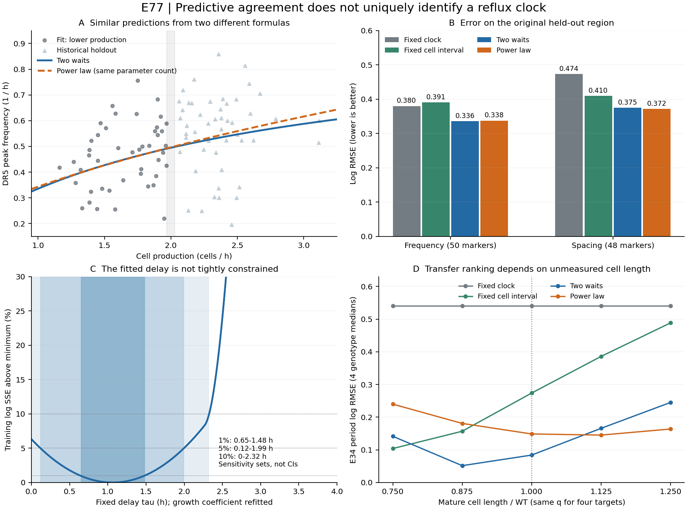
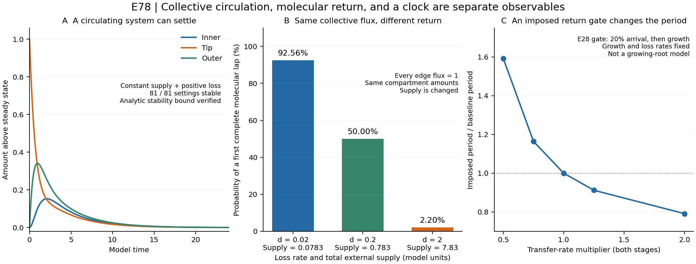

# 第19回研究報告 — 循環は、根のリズムをどこまで説明するか

2026-11-22（Asia/Tokyo）。基点は `f014dbd642342b9e2682c9bb677c529a672a01be`。研究ブランチは `research/reflux-clock-identifiability-20261122`。

## 結論

**根の周期をよく予測できたことは維持された。ただし、その成功だけから「分子が戻るまでの時間が時計を作る」と特定することはできない。** 同じ数の係数を持ち、帰路を指定しない成長の経験式も、元の研究の保留領域をほぼ同じ精度で予測した。別研究への移送では二待ち時間式が最良だったが、測れていない成熟細胞長の仮定によって順位が変わった。

一方、数理模型では、**集団としての循環を保つこと、同じ分子が一周すること、持続するリズムを生むことが、それぞれ別の性質である**と具体的に示せた。これは、循環を研究する際に何を観測し、何を条件としてそろえる必要があるかを明確にする結果である。

元の「循環同士の関係が形を生む」という仮説を、同じ分子が何度も戻る命題だけに限定しない。同時に、今回の区画模型や周期予測は、実空間のトーラスや全分野の共通生成原理の実証にはならない。今回の更新は、根に絞った予測と機構の識別である。

## 1. 今回の問いと、先に固定した方法

問いは「戻り輸送が根の周期的信号を作るという解釈を、ほかの説明からどこまで見分けられるか」。新しい解析の前に、[E77登録票](../research/registrations/E77-growth-law-specificity.md)と[E78登録票](../research/registrations/E78-circulation-and-clock.md)をコミット [`4d27d24`](https://github.com/sunpotflower4460-cpu/TORUS-mania/commit/4d27d24822b51697c989ad6e3ddfa56a8601ef57) で公開した。

E29・E34の成績と論文の傾向はすでに知っていた。従って**既刊データの探索的な追解析**であり、新規の盲検予測や新しい生体実験とは呼ばない。元のE29・E34の入力、係数、結果は変更せず、SHA-256で固定した。新しい独立データセットの加算は0である。

| 実験 | 比較 | 測定量 |
|---|---|---|
| E77 | 既存の固定周期・固定細胞間隔・二待ち時間に、同じ二自由度のべき則を追加 | 元の保留点の頻度・間隔、別研究4系統の周期、待ち時間と細胞長への感度 |
| E78-A | 一定供給・損失を持つ3区画の循環 | 81条件の安定性、摂動の減衰、収支 |
| E78-B | 集団の循環流束を同じにして、損失と補給を変更 | 同じ標識の一周率、条件付き帰還時間、補給総量 |
| E78-C | E28の二つの輸送率を変更、成長と損失は固定 | 初回到達の待ちと、それを使って課した周期 |

資料確認の範囲は[一次資料メモ](../research/notes/E77_E78_reflux_clock_mechanisms.md)、実アクセスと取得ファイルの識別情報は[アクセス記録](../research/access/2026-11-22-reflux-clock.md)にまとめた。

## 2. E77 — 同じ予測を、帰路を含まない式でも得られるか

元の二待ち時間式を、細胞生産率 `p`、周期 `T`、頻度 `f` として書くと、

\[
T=\tau+L/p,\qquad f=1/T.
\]

凍結された係数は `tau = 1.0617975 h`、`L = 1.9193863 cells`。比較相手は、帰路も輸送待ちも明示しない経験式、

\[
f=A p^b.
\]

どちらも頻度を決める係数は二つ。べき則は、元と同じ低生産側の頻度45図マーカーだけから調整した。間隔は全モデルで `s = p/f + delta` とし、低生産側の間隔38マーカーから各式に一つの補正を認めた。新しい係数は、pを細胞/時、fを1/時で数値化したとき、

\[
A=0.3434116,\qquad b=0.5320493,\qquad
\delta=-0.8624771\ \mathrm{cells}.
\]

これは実際の植物の仕組みを確定した式ではない。予測がどの機構に固有かを検査するための比較対象である。

### 保留領域と別研究への予測

誤差は対数RMSE。小さいほど、予測と観測の比のずれが小さい。頻度と間隔は同じ根の記録に関係するため、足し合わせて一つの有意差や複合尤度にしない。

| 式 | E29・頻度50マーカー | E29・間隔48マーカー | E34・周期4系統、細胞長比q=1 |
|---|---:|---:|---:|
| 固定周期 | 0.380225 | 0.473661 | 0.540573 |
| 固定細胞間隔 | 0.391047 | 0.409631 | 0.273886 |
| 二待ち時間 | **0.336481** | 0.375243 | **0.083994** |
| べき則 | 0.337778 | **0.371964** | 0.148594 |

E29では頻度は二待ち時間、間隔はべき則がわずかに良い。正式な統計的同等性を検定した結果ではないが、数値上の予測精度は近い。従来の二つの対照に勝ったという結果は再現する一方、**同程度の複雑さの別の式から、輸送待ちを識別するには足りない**。

E34では、対象側WTの伸長速度 `v0` と周期 `T0` で基準をそろえ、二待ち時間は `tau + (T0−tau)*v0/v`、べき則は `T0*(v0/v)^b` とした。対象4系統を使う係数調整はしない。ただしWTで再基準化しており、E29の全係数をそのまま別試料へ移した試験ではない。`tau`または`b`と関数形の移送である。

q=1のE34では、二待ち時間の優位が残った。特に最も遅いline2は、観測約7.57時間に対し、二待ち時間7.697時間、べき則5.688時間となる。別研究での予測成功を取り消す結果ではない。[全予測と採点](../research/results/E77/summary.json)



図Aは公開図から既に抽出された点と二つの式。Bは元の保留領域の誤差。Cは訓練側だけで作った待ち時間の感度。Dは未測定の細胞長への仮定感度で、実測の細胞長分布ではない。[SVG](../research/results/reflux_clock_figures/growth_law_specificity.svg)

### なぜ二つの式が似た傾向を出すのか

間隔補正を除いた `p/f` について、べき則なら `p/f = p^(1−b)/A`。**0 < b < 1なら、細胞生産が増えたとき頻度も間隔も増える。** 今回のbは約0.53で、この範囲に入る。

二待ち時間式の局所的な応答の指数も、

\[
\frac{d\log f}{d\log p}=\frac{L}{\tau p+L},
\]

となり、正のtauとLでは0と1の間にある。したがって、頻度と間隔の同時増加という特徴は、この範囲の成長応答に共通して現れる。これは式からの解析的帰結であり、新たな生体観測ではない。**観測した傾向と、その傾向を作る唯一の機構を区別する理由**になる。

## 3. 「1.06時間」は帰還時間として、どれくらい決まっているか

tauを0〜4時間、0.01時間刻みの401点へ固定し、各点でLを低生産側の頻度だけから推定した。各点で初期値0.1、2、10細胞を照合した。評価側の誤差を使ってtauを選んでいない。

| 最良の訓練対数SSEから許す増加 | tauの範囲 | 点数 |
|---|---:|---:|
| 1%以内 | 0.65〜1.48時間 | 84 |
| 5%以内 | 0.12〜1.99時間 | 188 |
| 10%以内 | 0〜2.32時間 | 233 |

これは登録した許容幅に対する**感度集合であり、信頼区間ではない**。5%や10%を統計的な採択基準として扱わない。最良値は約1.06時間だが、訓練側の適合をほぼ保ちながらtauとLを動かせる。1%集合でも、E34のline2の周期予測は6.44〜8.93時間に広がった。

全401点、3初期値、保留点への全予測を[CSV](../research/results/E77/tau_profile.csv)に保存した。対象側WTでの成長待ちが負になる設定を表示し、非正の周期が出る38設定も失敗数とともに残した。上表の三つの感度集合には、その問題のある設定は含まれない。

この感度に加え、E29のtauは頻度への適合定数であり、独立に測った輸送時間ではない。値が精密に決まった場合でも、それだけで分子の帰還時間だとは同定できない。

## 4. E34の良い予測は、細胞長の仮定にどれくらい依存するか

伸長速度 `v` と細胞生産率 `p` は、平均成熟細胞長 `c` を用いて `p=v/c` と結び付く。E34では系統ごとのcがそろっておらず、元の予測はWTと同じ長さを仮定していた。

そこで `q = 処置群の成熟細胞長 / WTの成熟細胞長` として、成長に依存する全モデルへ同じ変換 `v0/v → q*v0/v` を与えた。固定周期は不変である。

| 全4系統に共通のq | 固定細胞間隔 | 二待ち時間 | べき則 | この条件で最小の誤差 |
|---:|---:|---:|---:|---|
| 0.75 | **0.104004** | 0.141480 | 0.239920 | 固定細胞間隔 |
| 0.875 | 0.156946 | **0.051615** | 0.180893 | 二待ち時間 |
| 1 | 0.273886 | **0.083994** | 0.148594 | 二待ち時間 |
| 1.125 | 0.386075 | 0.165891 | **0.145163** | べき則 |
| 1.25 | 0.488668 | 0.245141 | **0.163786** | べき則 |

固定周期は全条件で0.540573。共通変化5条件に加え、各系統が独立に0.75/1.25となる16条件も保存した。**qをデータへ適合して最適化したわけではなく、この幅が実植物のばらつきだと測ったわけでもない。** 結果が、未測定量のどこに依存するかを調べたものである。

元の図の読取り端点1,024通りへのべき則追加は、登録後の補助解析として明記した。二待ち時間よりべき則が良い端点は465通りだが、乱数標本でも生物学的反復でもなく、主判定や成功確率には使わない。従来の二つの対照に二待ち時間が勝った969通りという結果は再現した。

## 5. E78-A — 循環が続けば、自動的に時計になるのか

内側I→先端T→外側O→内側Iという3区画を、一定の輸送率、正の損失率、一定の外部供給で結んだ。流束の循環という構造を与えた模型であり、3次元の根やトーラスが自然に形成される計算ではない。

量をx、輸送・損失行列をA、供給をsとすると `dx/dt = Ax+s`。非対角要素は非負で、第i列の和は損失率の負 `−d_i` になる。列についてのGershgorin境界から、

\[
\operatorname{Re}\lambda\le-\min_i d_i<0.
\]

従って定常状態 `x* = −A^−1 s` へのずれは減衰し、一定供給下に自律的な持続周期は生じない。登録した81条件すべてで確認した。複素固有値はあり得るが、それは減衰する振動のモードである。

基本条件の行列指数と別のODE積分の最大差は約 `5.18e−10`、収支残差は約 `4.97e−14`。単に長時間計算して振動が見えなかったという判定ではなく、解析的な安定性に基づく。

**この結論の範囲は、一定係数・正の損失・一定供給の線形模型である。** 細胞成長、非線形な反応、時間遅れ、移動する境界などを含む別の循環系へ一般化しない。Berg原著の成長する細胞モデルを否定する結果でもない。

## 6. E78-B — 同じ分子の戻りやすさが違っても、集団の流れは保てるか

三つの辺の流束をすべてJ=1にし、各区画量を `x_i=J/k_i` で同じに保った。損失率dを変え、それに釣り合う補給 `s_i=d*x_i` を各区画へ与えた。外からの補給も方向付き輸送も設定した模型である。

Iから出発した同じ標識が、TとOを経て、失われる前にIへ初めて戻る確率は、

\[
P_{\mathrm{return}}=\prod_i\frac{k_i}{k_i+d}.
\]

| 損失率d | 各辺の流束 | 総補給量 | 同一標識の一周率 | 損失までの平均完成周回数 |
|---:|---:|---:|---:|---:|
| 0.02 | 1 | 0.078333 | 92.5626% | 12.4456 |
| 0.2 | 1 | 0.783333 | 50.0000% | 1 |
| 2 | 1 | 7.833333 | 2.1978% | 0.022472 |

**同じ量・同じ集団流束でも、同一分子の一周率は約92.6%から約2.2%まで異なった。** 流れを維持する関係と、構成する分子の再使用率は同値ではない。

ただし、補給総量は100倍の幅がある。同じ投入条件や同じエネルギー費用で維持できたという比較ではない。エネルギーの仕事率、IAAの化学変換、実植物の時間・幾何はモデル化していない。実植物でこの3条件が生じると実証したわけではない。

帰還に成功した分子に限った平均時間は3.813、3.083、1.075。損失が強いと遅い分子が途中で失われるため、成功群だけの平均は短くなる。この選別を含む量と再使用率を分ける必要がある。帰還確率、条件付き時間、周回数は独立な吸収行列・ODE・累積報酬の計算と照合した。[全条件・式・検算](../research/results/E78/summary.json)



図Aは一時的に加えた量が定常状態からのずれとして減衰する様子。Bは同じ流束を異なる補給で保った3条件。CはE28で課した初回到達の閾値と成長待ちの規則。[SVG](../research/results/reflux_clock_figures/circulation_vs_clock.svg)

## 7. 原著と簡略模型は、どこで区別できるか

Bergらの原著モデルは、成長・分裂による細胞サイズの変化と、サイズに応じたオーキシンの取り込み・排出から周期的な信号を生成する。パルス時刻を外から列挙するものではない。一方、既存の根の組織と輸送体配置、成長・分裂の規則を与えている。[原著accepted版 pp.3–5, 19–28](https://biblio.ugent.be/publication/8717001/file/8717002.pdf)

E28の`event_sequence`は、「先端→外層→内側への初回到達を待つ」「所定の細胞生産を待つ」を繰り返す規則を明示的に持つ。これはBerg原著の細胞モデルの再現でも、原著から同等性が導出された式でもない。今回のE78-Cでは、この区間の輸送率を変えると次の予測を出した。

| 二つの輸送率の倍率 | 初回20%到達までの時間 | 課した周期T | 基準に対する周期比 |
|---:|---:|---:|---:|
| 0.5 | 3.183921 | 5.183921 | 1.591384 |
| 0.75 | 1.791348 | 3.791348 | 1.163885 |
| 1 | 1.257493 | 3.257493 | 1 |
| 1.25 | 0.970648 | 2.970648 | 0.911943 |
| 2 | 0.577503 | 2.577503 | 0.791254 |

時間は規格化された模型単位。全条件で20%へ到達した。先端から内側への区間であり、Iから出た同じ分子の全周回とは区別する。輸送率半分なら周期は約59.1%延び、2倍なら約20.9%短くなる。

これに対し原著accepted版p.28では、著者が検査した供給・輸送効率などの変更は主に振幅へ、分裂帯と分裂率は頻度・間隔へ作用すると記されている。モデルで根端向きPINだけを残した条件や、維管束細胞の成長を除いた条件では振動が失われる。前者は複合的な輸送の操作で、帰路だけを選択的に切った試験ではない。

**次に見分けたいのは、成長を測定した条件で、戻り輸送への介入が振幅・位置・周期のどれを変えるかである。** ただし、今回の二つの輸送率変更と原著の輸送体操作の対応は確立していない。数値が違うことを原著の反証とは呼ばない。原著コードは公式配布先へアクセスしたが取得できず、完全な同条件比較は未実施である。

## 8. 測っている信号と、残るデータの不足

De Gernierらの2025年研究は、DR5::LUC発光ピークが初期primingより後に現れることを報告し、発光周期を初期のリズムの近似に使うことも認めている。一定の遅れをすべてのイベントへ加えるだけなら周期は変わらない。後続信号であることだけで予測を無効にしないが、E34を同じIAAの一周や初期primingの直接測定とは扱わない。[原著accepted版 p.10](https://biblio.ugent.be/publication/01K47A0QNA2VHHET9FD517S20G/file/01K47CJF9R1X89CRS2EQVDNXRH.pdf)

Bergの頻度・間隔・細胞生産は同じ根に由来し、細胞生産率と細胞数単位の間隔には成熟細胞長という共通の分母がある。間隔にはピーク数nによる `−n/(n−1)` の補正も含まれる。元の個体ID、処置群、ピーク数を図のマーカーから復元できていないため、独立な二つの試験として数えず、個体単位の統計検定を作らなかった。[原著accepted版 pp.16–19](https://biblio.ugent.be/publication/8717001/file/8717002.pdf)

個体別に優先してそろえたい列は、`root_id, treatment, growth_velocity, mature_cell_length, n_peaks, peak_times, peak_positions, meristem_size`。De Gernierの公開補足にはImageJマクロと根・ピーク・時刻の対応項目があるが、原画像と個体CSVは未取得で、Data availabilityは著者への依頼による提供だった。今回は外部への連絡を行っていない。

## 9. 主張台帳をどう更新したか

| 主張 | 更新 |
|---|---|
| H29・H34：指定した対照より周期等をよく予測する | 元の条件内支持を保持。比較相手と細胞長仮定に対する限界を追加 |
| H28：二つの待ちを課すと頻度と間隔がともに増える | 数理的結果を保持。周期の反復規則を与えたこと、原著の細胞模型との違いを明示 |
| H79：一定係数・正の損失の線形循環は、一定供給下で持続周期を自律生成しない | 解析境界と81条件による数理的支持 |
| H80：同じ集団循環流束でも、補給・損失が違えば分子一周率は異なる | 補給条件を明示した構成例で支持 |
| H44：同一天然IAAの根での全周回 | 未判定を維持。集団の循環一般の必要条件とはしない |
| H45、H05、H08など：形態形成・樹木・普遍的生成原理 | 今回は直接検証していないため未判定を維持 |

今回の解析から、根では「循環の存在」「循環が信号を支えること」「帰還時間が周期を決めること」を別々に検証する方針が具体化した。これが、元の発想を観測で確かめるための次の焦点になる。

## 10. 再実行と検証

Python依存は既存の[experiments/requirements.txt](../experiments/requirements.txt)。追加の購入・APIキー・ネットワーク取得を要しない。リポジトリの根から、

```bash
python -m experiments.run_reflux_clock --out /tmp/torus-reflux-clock-replay
cd /tmp/torus-reflux-clock-replay
sha256sum -c REFLUX_CLOCK_SHA256SUMS
```

E77の14件、E78の17件、合計31件の検算を実行する。元の係数と誤差の再現、入力のハッシュ、閉形式との一致、全登録条件の保存、解析解と独立ODE、物質収支を確認した。数値検算の通過を、生物学的仮説の証明や31件の独立追試とは数えない。

[実行記録](../research/results/REFLUX_CLOCK_RUN.json)・[出力ハッシュ一覧](../research/results/REFLUX_CLOCK_SHA256SUMS)・[E77実装](../experiments/E77_growth_law_specificity/run.py)・[E78実装](../experiments/E78_circulation_clock/run.py)。同じ入力・コード・依存環境で、別の空の出力先へ再実行し、数値表・時系列・図の9成果物、実行記録、ハッシュ一覧がバイト単位で一致することを確認した。これは同じ環境での計算再現で、別実装による生体の独立追試ではない。
