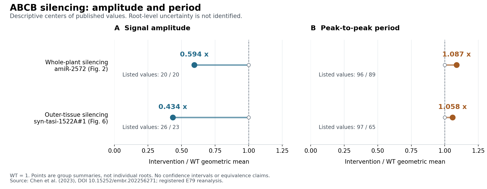

# 第20回研究報告 — 戻り方向の輸送は、信号の強さと周期をどう変えるか

2026-11-22（Asia/Tokyo）。第19回の `39513901949d240066e066f5dfd41a1db9808c6f` を継承し、`research/reflux-clock-identifiability-20261122` で研究を続けた。

## 結論

**根の外側を地上部方向へ進むオーキシン輸送に関わる介入で、DR5発光の振幅が大きく下がるという実測の根拠が加わった。一方、「輸送を弱めても周期は変わらない」までは、取得できた表から確定できない。** 周期の掲載値の算術平均は約6〜10%長くなっていた。個体IDと反復測定の対応がなく、根単位の効果や同等性の区間を復元できないためである。

今回の追加はChenら2023年の**著者が公開した図データ1研究**。E79で振幅・周期、E80で輸送測定と成長の条件を調べた。同じ研究を二重に数えず、新しい植物実験や生体での独立再現とは呼ばない。元のE77・E78の数値・コードは変更していない。

この結果は、「物質がどの組織を通るかが、形の準備信号に関わる」という具体的な部分を支える。循環の全経路、同じ分子の一周、循環が唯一の時計を作ること、三次元トーラスや自然界全体の共通生成原理は、今回の直接測定の範囲に入らない。

## 1. 今回進めた問い

前回残った問いは、**成長・細胞生産を独立に測ったとき、戻り輸送への介入は信号の強さ・位置・周期のどれを変えるか**、だった。

主対象は [Chen et al. (2023), *ABCB-mediated shootward auxin transport feeds into the root clock*](https://doi.org/10.15252/embr.202256271)。ABCB15/16/17/18/22に関わる全身的な抑制 `amiR-2572` と、根の外層に絞った抑制 `syn-tasi-1522A#1` を、各試験の野生型WTと別々に比較した。

論文の方向性と原表の列構造は既知だった。効果量の計算前に [E79登録](../research/registrations/E79-abcb-clock-source-data.md)・[E80登録](../research/registrations/E80-abcb-transport-growth-audit.md) をコミット [`6ccbe7d`](https://github.com/sunpotflower4460-cpu/TORUS-mania/commit/6ccbe7dfcab0e96db4ee4fec4badfd19cd631e4e) で公開した。既刊データの追解析であり、未見データへの盲検予測ではない。

元ファイルのURL・SHA-256、sheet・cell範囲・年齢・観測単位は [source manifest](../research/sources/chen2023_manifest.json)、本文・補足図との対応は [資料監査メモ](../research/notes/chen_2023_source_schema.md) に保存した。

## 2. E79 — 振幅と周期を別々に再計算した結果

相対量の主指標は、各群の正値を対数平均して戻した**幾何平均の介入/WT比**。読みやすさのため、原単位の算術平均とその比も併記する。どちらも**掲載された数値行に重みを置く記述統計**で、根ごとの独立な推定値とは限らない。

| 比較 | 指標 | WTの算術平均 | 介入の算術平均 | 算術平均比 | 幾何平均比（主指標） |
|---|---|---:|---:|---:|---:|
| 全身的抑制・Fig.2 | DR5発光振幅 | 43.004 | 25.400 | 0.5906 | **0.5943** |
| 全身的抑制・Fig.2 | ピーク間周期（時間） | 3.4375 | 3.7669 | 1.0958 | **1.0868** |
| 外層特異的抑制・Fig.6 | DR5発光振幅 | 93.5879 | 43.7131 | 0.4671 | **0.4344** |
| 外層特異的抑制・Fig.6 | ピーク間周期（時間） | 3.8299 | 4.0615 | 1.0605 | **1.0575** |

振幅の原表の単位表記は `ADU 15min^-1`。15分ごとの撮影におけるROI内の発光のmax−minで、オーキシンの物質量・輸送速度や信号の時間微分へ換算していない。Fig.2とFig.6の絶対発光量を直接比較せず、それぞれのWTを基準にする。

幾何平均比では振幅は約41%・57%低下。一方、周期の中心は約9%・6%長い。**観測値の中心で振幅への変化が大きいことと、周期の不変性を証明することは分ける。** 周期の差をゼロに丸めない。[全記述統計](../research/results/E79/summary.json)



[同図のSVG](../research/results/abcb_clock_figures/abcb_clock_ratios.svg)

### 個体単位の同等性を判定しなかった理由

| 図 | 図説明のn（WT / 介入） | 周期の数値行数 | 振幅の数値行数 |
|---|---:|---:|---:|
| Fig.2 | 21 / 21 | 96 / 89 | 20 / 20 |
| Fig.6 | 27 / 23 | 97 / 65 | 26 / 23 |

PDFの原図・captionとxlsxの見出しを照合しても、この相違を解消するroot ID、event ID、batch IDは見つからなかった。周期が同じ根からの複数間隔である可能性はあるが、対応がないため断定できない。振幅の少ない行を補充したり、周期の行を図のnに合わせて削ったりしなかった。

同じ根が何回測られたか分からない場合、影響するのは標準誤差だけではない。根iが `m_i` 個の周期を提供したなら、

\[
\text{掲載周期の平均}=\frac{\sum_i m_i\bar T_i}{\sum_i m_i},
\qquad
\text{根を等しく重み付けした平均}=\frac{1}{K}\sum_i\bar T_i.
\]

この二つは一般に異なる。独立行と仮定したp値や信頼区間を付けても、根単位の問題は解決しない。そのため、登録通り、**根単位の95%信頼区間、周期の同等性、個体内の振幅と周期の相関は未同定**とした。±10%・±20%の周期変化を排除したとも言わない。原著の「有意差なし」を自分たちの同等性判定として引き継いでいない。

これは公開表から再解析できる範囲の制約であり、行数の差だけで原著解析が誤っていると断定した結果ではない。

## 3. E80 — 実際に戻り方向の輸送が変わったと言えるか

Fig.4Aの放射標識測定では、根端に与えたIAA由来標識の地上部方向の回収dpmが、全身的抑制で減っていた。対照として同時に掲載された安息香酸BAも、同じ方法で集計した。

| 標識 | WTの掲載値数 | 介入の掲載値数 | WT平均（dpm） | 介入平均（dpm） | 介入/WT平均比 |
|---|---:|---:|---:|---:|---:|
| IAA | 3 | 3 | 256.6667 | 139.3333 | **0.5429** |
| BA | 4 | 3 | 842.2500 | 799.0000 | **0.9486** |

IAA回収の平均低下は約46%、BAは約5%。同じ指標の方向として、IAAの地上部向き輸送への寄与に整合する。少数の掲載値を独立した根と決めつけず、BAの無影響や二つの効果の統計的差を新たに証明したとはしない。[E80の集計と監査](../research/results/E80/summary.json)

本文は輸送手順をLewis & Muday (2009)へ参照するが、このFig.4Aの測定に用いた年齢、poolした根の本数、採取時刻・区画の具体値は取得本文・表から確定できなかった。参照手順の代表値を、そのまま今回の実施条件として代入しない。

また、この輸送測定は `amiR-2572`。Fig.6の外層特異的抑制について、同じ直接測定を実施したという表ではない。遺伝子発現の場所と組織特異的介入は経路の解釈を補うが、異なる群の測定を同じ根の因果鎖へ結び付けない。

### 原表のSEラベルについての照合

Fig.4Aの平均行は、観測値だけからの再計算と一致した。行9は全列 `S.E.` と表示されるが、IAA列は標準誤差SEM、BA列は標本標準偏差SDと数値が一致する。

| BA | 原表の行9 | 観測値からのSD | 観測値からのSEM |
|---|---:|---:|---:|
| WT | 216.9199 | 216.9199 | 108.4600 |
| amiR-2572 | 157.6927 | 157.6927 | 91.0439 |

平均比には影響しない。今回の表では、原表の行9をそのまま標準誤差として流用しなかった。公開ファイルを修正せず、ラベルと算術的対応の相違として記録した。登録票の `4A` はパネル名であり、実際のZIP内部ファイルは `Figure 4.xlsx`、sheetは `Figure 4`。集計セルの範囲は登録から変更していない。

## 4. 成長をそろえた時計機構の比較まで進めたか

**ここは未到達である。** 生育の測定があることと、時計の計測中に同じ根の細胞生産が分かることは違う。

| 必要な接続 | 公開資料で確かめた範囲 | 今回の判定 |
|---|---|---|
| 輸送介入と時計 | 同じ全身的抑制系統の輸送測定とDR5時計。外層特異的抑制も時計を測定 | 条件を限定した接続あり。個体内の同時測定ではない |
| 時計と細胞生産 | 時計は3日齢。Fig.2D–Fの分裂組織・LRC形態は5日齢 | 同条件の細胞生産率は未取得 |
| 細胞の長さ | Fig.2Fは遠位LRC細胞長 | 成熟した皮層細胞長cに代用できない |
| 根の伸び | 根長の終点測定はある | 時計撮影中の伸長速度vとは同一でない |
| 振幅と発光の選択 | PBSができる位置のROIでmax−minを測る | PBSにならなかった全イベントの振幅分布・検出欠落を復元できない |
| 空間位置 | PBS密度や代表画像はある | 根を追跡した位置時系列と対応がなく、今回の位置効果は未推定 |

成長の近似 `p ≈ v/c` を使うにも、対応する細胞列・年齢・時間窓と、定常的な細胞の流れを仮定できるかの確認が必要になる。今回の5日齢のLRC長や終点の根長で、3日齢のpを埋めなかった。

Chenら自身は、分裂組織が小さいのに周期が変わらないという観測を、reflux-and-growthの説明と比較している。しかし、こちらの再解析では、成長・個体対応の不足を保留した。Berg原著の細胞モデルを実行・再適合して棄却したわけではない。

E78-Cの「二つの輸送率を半分にすると課した周期が1.591倍」という値とも直接比較しない。今回の回収dpm比0.543は、供給、保持、損失、代謝、採取条件を含み得る量で、一階輸送率二つの同率低下には換算できない。

## 5. 振幅だけを普遍的な生成条件にしない

文献比較として、[Wang et al. (2023), DOI:10.1111/nph.19284](https://doi.org/10.1111/nph.19284) も本文と補足を確認した。別の介入 `gh3hex` では、DR5::LUCの振幅低下と、PBS形成の高い成功率が併存すると報告されている。分裂組織の拡大と成熟細胞の短縮も報告され、根長だけで細胞生産を代表できないという前回の懸念に具体的な比較材料がある。

今回はこの論文の図を新しく数値化しておらず、研究の再集計件数に加算しない。両研究の著者には重なりがあり、独立な再現とも呼ばない。この文献上の比較からの含意は、**DR5の振幅、オーキシン量、PBS成立、最終的な枝の数を一つの変数にまとめない**こと。今回のABCB条件で振幅と分岐が一緒に下がるという結果を、すべての介入へ一般化しない。

## 6. 元の仮説について更新できた部分

| 主張の段階 | 今回の更新 |
|---|---|
| 向きと組織を持つ輸送の関係が、形の準備信号に関わる | ABCB介入の輸送・振幅という具体的な材料が増えた。条件内の支持 |
| 戻り方向の輸送が、周期を一意に決める | 未同定。観測値の周期中心は少し長く、成長・反復単位をそろえた推定はできない |
| 循環・成長・応答が結び付き、場所や枝の形成を調節する | 研究を進める価値のある機構の組合せ。今回の全データを一つの共通方程式で予測したわけではない |
| 同じ物質の一周、三次元トーラス、分野横断の共通生成原理 | 新しい直接判定はない。元の強い問いは維持する |

「関係が形を作る」という元の考えを、何にでも当てはまる言い換えだけへ縮めない。そのために今回明確にしたのは、経路を変えた後に**何がどの程度変わり、どの観測はまだつながっていないか**である。次は、その関係を同じ個体の測定と定量予測へつなぐ必要がある。

## 7. 再実行と次の研究

取得原本はGitへ同梱せず、公開URLと固定ハッシュで取得する。解析コードは、原表の値や構造を書き換えない。実行方法・原著コード探索の到達範囲は [アクセス記録](../research/access/2026-11-22-abcb-clock.md)、数値結果は [E79](../research/results/E79/summary.json)・[E80](../research/results/E80/summary.json)、実行記録は [ABCB_CLOCK_RUN.json](../research/results/ABCB_CLOCK_RUN.json) を参照。

```bash
python -m experiments.run_abcb_clock --out /tmp/torus-abcb-clock-replay
cd /tmp/torus-abcb-clock-replay
sha256sum -c ABCB_CLOCK_SHA256SUMS
```

原本の取得と入力の照合を含む詳しいオプションは同モジュールの `--help` にある。依存は既存の `experiments/requirements.txt` を使う。出力は [SHA-256一覧](../research/results/ABCB_CLOCK_SHA256SUMS) で追跡する。

入力・数値の検算23項目が通過した。二つのXML読取り経路と浮動小数点/Decimal計算で照合し、別のread-only workbook readerでも12群の件数・中心・SDが一致した。さらに別エンジンで時計の8列を照合した最大スケール差は `7.30e-16`。空のcacheに公開原本3点を再取得し、空の出力先で再実行したところ、数値2点・図2点・実行記録・SHA一覧の計6ファイルがバイト一致した。Python 3.12.14、Matplotlib 3.10.8の同じ環境での計算再現であり、生体の独立追試ではない。

次に必要なのは、追加の見た目の例より、**root IDを保った時計の時系列と、その撮影中の成長測定**である。測定計画は次の対応を保つ。

1. 根ごと・撮影ごとのIDをそろえ、全ピーク時刻、振幅、検出できなかった区間、PBSになったかを保存する。
2. 同じ時間窓の伸長速度と対応する成熟細胞長を独立に測り、細胞生産の差を評価する。
3. 輸送への操作、細胞分裂・伸長への操作、両者を組み合わせた条件を区別し、周期・振幅・位置・PBS成立率を別々に予測する。
4. 既存の二待ち時間式と別の成長則について、同じ観測量と同じ未使用条件で評価する。回収dpmを輸送速度と同一視しない。

公開資料で次に近づける候補はWang2023の成熟細胞長と時計の対応である。ただし個体表は未取得。Berg2021・PBSroot2022の原版コードは追加探索でも取得できず、別年のモデルを原版として代用していない。取得できなかったことを資料の不存在とは解釈しない。
